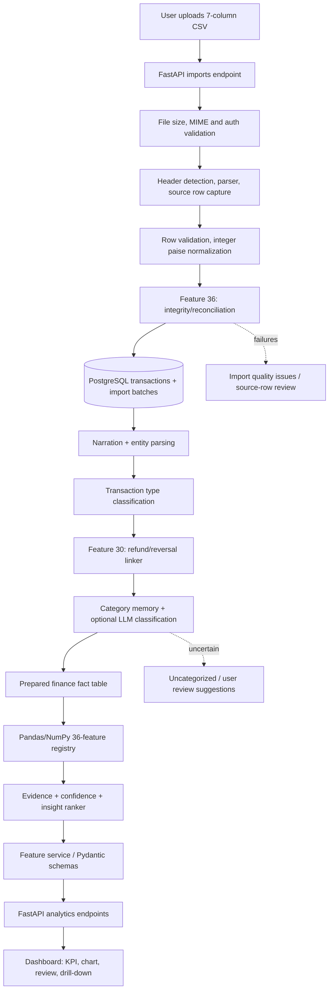
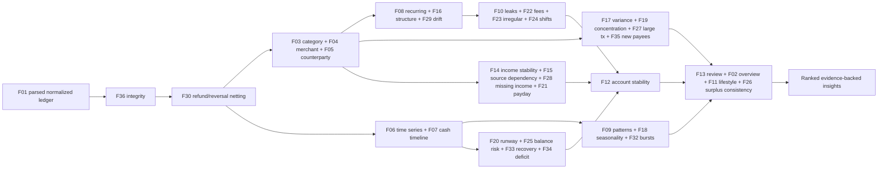

# Personal Finance AI · Pillar 1 — UNDERSTAND

**Production-oriented README / backend architecture / 36-feature calculation specification**

> **Status:** implementation blueprint, not an implemented backend.  
> **Scope:** one bank-statement-driven **financial data analysis and insights** service using **FastAPI, Pandas, NumPy and PostgreSQL**. No Pillar 2 predictive ML product, no Pillar 3 split/budget management, no Pillar 4 agent, no MCP, no RAG/CRAG. An optional *semantic categorization* model is an enrichment adapter, not the finance calculation engine.
>
> **Canonical input:** only the seven fields below. All others described in this README are **derived from those fields** or are local processing metadata/approved classification memory. No budget, asset portfolio, credit history, holiday/event calendar, employment agreement or other account statement is assumed.

## Navigation

1. [Product purpose and bounded scope](#1-product-purpose-and-bounded-scope)
2. [Input statement and demo-file realities](#2-input-statement-and-demo-file-realities)
3. [Financial truth, data semantics, and calculation policies](#3-financial-truth-data-semantics-and-calculation-policies)
4. [Data model and derived transaction contract](#4-data-model-and-derived-transaction-contract)
5. [Full backend folder structure](#5-full-backend-folder-structure)
6. [System architecture and dependency wiring](#6-system-architecture-and-dependency-wiring)
7. [Upload, validation, typing, refund netting and classification](#7-upload-validation-typing-refund-netting-and-classification)
8. [API routes and response contracts](#8-api-routes-and-response-contracts)
9. [Canonical 36-feature catalog with full logic](#9-canonical-36-feature-catalog-with-full-logic)
10. [Data coverage, confidence and cross-feature insight ranking](#10-data-coverage-confidence-and-cross-feature-insight-ranking)
11. [Testing, acceptance criteria, and example fixtures](#11-testing-acceptance-criteria-and-example-fixtures)
12. [Security, privacy, and operational rules](#12-security-privacy-and-operational-rules)
13. [Implementation sequence](#13-implementation-sequence)
14. [What this pillar cannot know](#14-what-this-pillar-cannot-know)

---

## 1. Product purpose and bounded scope

**Purpose:** Convert a messy statement into evidence-backed financial understanding: **what happened, to whom, how frequently, why totals changed, and how robust the observed cash position looks**. The deliverables are clean transactions, verified financial KPIs, transparent category/entity enrichment, profiles, time series, root-cause drivers, and useful review cards.

**Human outcome:** Save time reviewing finances; avoid double-counting transfers/refunds; identify recurring commitments and costly habits; understand money-arrival gaps and liquidity pressure; inspect the source rows behind every displayed insight.

**The 36 features stay at 36.** The additional metrics from `changes.txt` are **integrated inside their original parent feature**, not appended as additional main features. All features share one normalized ledger, one classification service, one metric registry, and one consistent definition of inflow/outflow and consumption.

**No financial transaction initiation.** The service reads statements and may save derived labels; it does **not** send money, control bank accounts, infer legal debts, or offer investment/tax advice.

### Feature ownership vs reusable calculations

| Reusable foundation | Authoritative owner | Consumers |
|---|---|---|
| Import validity and row identity | F01 + F36 | Every feature |
| Monetary raw/effective semantics | F30 + transaction typing | F02–F35 |
| Category taxonomy + confidence | F03 | F10, F11, F12, F16–F19, F20, F24 |
| Merchant identity and profile | F04 | F08, F10, F17, F19, F27, F29, F35 |
| Counterparty identity / direction | F05 | F14, F15, F28, F35 |
| Complete calendar / complete months | F06 | F07, F09, F11, F13, F18, F21, F25, F26, F32–F34 |
| Recurrence groups and cadence | F08 | F16, F20–F23, F28–F29 |
| Canonical income-like stream | F14 | F02, F11–F12, F15, F21, F26, F28 |
| Liquidity burn and runway | F20 | F12, F28, F34 |
| Refund/return pair allocation | F30 | All spending/income dashboards |

---

## 2. Input statement and demo-file realities

### 2.1 Seven external columns — exact raw contract

| Original name | Normalized field | Meaning | Expected parse type |
|---|---|---|---|
| `Date` | `date` | Bank posting/booked date | `date` (day-first for demo) |
| `Narration` | `narration_raw` | Unstructured bank description | UTF-8 string, preserve original |
| `Chq./Ref.No.` | `reference_no` | Cheque/payment reference | string, **not guaranteed unique** |
| `Value Dt` | `value_date` | Bank value/effective date | `date`; may differ from Date |
| `Withdrawal Amt.` | `withdrawal_minor` | Money debited from this account | integer paise |
| `Deposit Amt.` | `deposit_minor` | Money credited to this account | integer paise |
| `Closing Balance` | `closing_balance_minor` | Balance reported after transaction | signed integer paise |

**Format-specific file observations:** the supplied sample is an HDFC-style CSV with the real seven-column header at row 21, metadata above it and non-transaction material after it. There are **281 transaction-format rows**. The period visible in the supplied material is **26 Aug 2025–06 Mar 2026** (roughly six months); UPI narrations dominate. The CSV includes reversal-like entries and repeated references, so a reference number is **not** a unique transaction key. These details are sample-specific, not assumptions about every future bank file.

Never place actual account-owner names, payment handles, reference values or private narrations in the public README, examples, trace logs or Git repository. Use synthetic test records.

### 2.2 Parser contract

- Locate the table header by schema matching rather than fixed `skiprows=20` (although the sample header occurs at row 21).
- Retain `source_file_id`, `source_row_number`, `statement_order` and a raw-row checksum.
- Recognize the transaction rows using bank-adapter date rules; preserve rejected rows and reasons.
- Convert comma-separated numeric amounts with `Decimal` → integer paise; prohibit binary float persistence.
- Parse the sample `DD/MM/YY` explicitly, not via automatic ambiguous day/month inference.
- Allow valid zero closing balances and signed/overdrawn balances; do not reject them solely because they are nonpositive.
- Re-importing an identical file must create no duplicate ledger events.
- Preserve the imported order; also expose an explicit posting-date view for time aggregations.

### 2.3 Data availability classification

| Evidence level | Data | What we can claim |
|---|---|---|
| **Direct (D)** | Dates, monetary inflow/outflow, statement balance, reference, narration text | Actual recorded account movements |
| **Parsed (P)** | Payment mode, merchant/counterparty *candidate*, UPI handle, normalized remark | Candidate identity and payment mechanism, with parse confidence |
| **Classified (C)** | Category, entity type, income-like flag, fee/investment/refund labels | Estimated meaning based on text/rules, with explicit uncertainty |
| **Pattern-derived (T)** | Repeat cadence, baseline, runway, alerts, inferred subscriptions | Statistical inference; confidence/history gates required |
| **Unavailable (X)** | True user income, confirmed loans/IOUs, complete net worth, budgets, item-level purchases, intraday timing, bank holidays | Must not be fabricated |

---

## 3. Financial truth, data semantics, and calculation policies

### 3.1 Money, dates and ordering

- **Money:** `withdrawal_minor`, `deposit_minor`, `closing_balance_minor` are signed/unsigned integers in the account currency’s minor unit. The external API serializes these as integers with `currency="INR"` and may present formatted rupees to the frontend; no float money math.
- **Direction:** `INFLOW` when deposit>0, `OUTFLOW` when withdrawal>0; blank zero/zero lines are rejected/quarantined unless the bank adapter explicitly supports them. Both-positive entries require review.
- **Account balance:** closing balance always comes from the statement and is **not** computed by grouping by merchant. A row-level balance reconciliation validates it.
- **Posting Date vs Value Date:** reporting groups by `Date` by default; settlement lag uses `Value Dt − Date`. Value date alone cannot prove withdrawable funds.
- **Order:** `statement_order` preserves bank order; `date_order` groups by posting date with stable ties. Do not reorder same-day transactions to make an error disappear without user review.
- **Partial months:** calculate actual observed day counts; avoid comparing a full previous month with a partial current month.
- **Daily zeroes:** insert zero-transaction days for daily averages, streaks and weekday analysis; forward-fill day-end balance only within observed coverage, and mark forward-filled days.

### 3.2 Three monetary views — use the correct one

```text
RAW BANK MOVEMENTS (verified ledger)
  raw_inflow  = Σ all deposit_minor
  raw_outflow = Σ all withdrawal_minor
  raw_net     = raw_inflow − raw_outflow

CLASSIFIED FINANCE FLOWS (conservative)
  matched_refund_allocations = confirmed refund/reversal links
  own-account transfers     = confirmed internal movements
  investment movements     = separately labeled balance-to-asset movements

CONSUMPTION / INCOME-LIKE ESTIMATES
  effective_spend = Σ classified consumption debits − matched consumer refunds
  income_like     = Σ confidently identified income-like credits
  estimated_surplus = income_like − effective_spend   [proxy, not verified savings]
```

**No double counting:** one reversal reduces its linked purchase's net spend and is excluded from genuine new income; a transfer between the user’s own accounts is a movement, not consumption or earned income; an ATM withdrawal converts bank money into cash and does not reveal how the cash was eventually spent. An investment outflow can reduce the bank balance without representing consumption. Unknowns remain `unclassified`, not assumed spend/income.

**Important distinction:** A same-amount opposite flow between two people may be a repayment, a refund, a loan, or unrelated activity. Do not net two payments merely because the amounts match. Only confirmed linked refunds/reversals are netted automatically.

### 3.3 Denominator and comparison rules

```text
raw_net_inflow_ratio = raw_net / raw_inflow                if raw_inflow > 0
raw_outflow_to_inflow = raw_outflow / raw_inflow            if raw_inflow > 0
estimated_savings_proxy = estimated_surplus / income_like if income_like > 0 and reliable
category_share = category_effective_spend / total_effective_spend, when denominator > 0
MoM_growth = (current−previous)/previous                  if previous > 0 and months comparable
counterparty_net_flow = received−sent                    [NOT automatically debt]
```

Store null plus status (`undefined_denominator`, `insufficient_history`, `low_confidence`) rather than infinite percentages. Signed raw `net` is a genuine accounting movement; label it `net cash flow`, not “profit”.

### 3.4 Required quality gates

1. F01 parses. F36 reconciles and returns `data_quality_status`.
2. Entity and transaction-type enrichments carry provenance and uncertainty.
3. F30 allocates confirmed refunds and removes them from effective spend and effective income-like amounts.
4. Core analytics reuse the *same prepared fact table* and consistent time windows.
5. Each feature responds with `method`, `formula_version`, `history_months`, `confidence`, `evidence`, and gate statuses.
6. The frontend shows **raw**, **classified**, and **estimate/scenario** numbers with distinct labels.

---

## 4. Data model and derived transaction contract

### 4.1 Normalized transaction — data dictionary

| Group | Derived/storage fields | Derivation / rule |
|---|---|---|
| Identity/provenance | `id`, `account_id`, `import_batch_id`, `source_row_number`, `statement_order`, `raw_row_hash`, `candidate_duplicate_hash` | Created during ingestion; do not use bank reference alone as ID |
| Original data | `date`, `value_date`, `narration_raw`, `reference_no`, `withdrawal_minor`, `deposit_minor`, `closing_balance_minor` | Exactly seven raw columns, typed and preserved |
| Core arithmetic | `signed_amount_minor`, `amount_minor`, `direction`, `settlement_delay_days` | `deposit−withdrawal`, `deposit+withdrawal`, direction and `Value Dt−Date` |
| Calendar | `day`, `weekday`, `is_weekend`, `week`, `month`, `quarter`, `year`, `fy_apr_mar`, `day_of_month` | Derived from `Date` |
| Narration parser | `narration_clean`, `payment_mode`, `name_candidate`, `vpa_candidate`, `ifsc_candidate`, `remark_norm` | Deterministic rail-specific parsing; unknowns allowed |
| Entity | `payee_key`, `merchant_key`, `counterparty_key`, `entity_type`, `entity_confidence`, `alias_group_id` | Canonicalization + approved merge memory |
| Category | `category`, `category_confidence`, `category_source`, `category_reason`, `classification_version` | Approved label/memory/LLM; no category guessing |
| Transaction typing | `transaction_type`, `type_confidence`, `is_refund_candidate`, `is_self_transfer_candidate`, `is_fee_like`, `is_cash_withdrawal`, `is_investment_like`, `is_income_like`, `is_test_like` | Evidence from narration, link rules and repeat patterns |
| Linkages | `refund_link_id`, `transfer_link_id`, `related_transaction_id`, `allocated_refund_minor` | Only when supported by matching evidence |
| Effective flows | `effective_spend_minor`, `income_like_minor`, `unclassified_outflow_minor`, `unclassified_inflow_minor` | Consistent classified monetary views; nonnegative where appropriate |
| Patterns | `recurring_group_id`, `recurrence_class`, `recurrence_confidence`, `transaction_size_band` | Derived after entity normalization |
| Trust | `row_quality_status`, `row_quality_score`, `reconciliation_break_minor` | F01/F36 |

`Amount_minor` may be represented as the nonzero debit or credit magnitude; direction is stored separately. All raw fields are immutable; corrections to derived labels are tracked with audit fields.

### 4.2 Core persistence schema (minimal, modular monolith)

| Table | Essential fields | Why it exists |
|---|---|---|
| `accounts` | `id`, `currency`, `nickname`, `opening_balance_minor?` | Account scope and currency separation |
| `import_batches` | `id`, `checksum`, `file_name_masked`, `adapter`, `version`, `row_count`, `accepted`, `rejected`, `status`, `quality_score` | Idempotency, provenance, import report |
| `transactions` | Seven normalized fields + stable IDs/order, `account_id`, `import_batch_id`, type/status, fingerprints | Source of truth for analytics |
| `transaction_labels` | `transaction_id`, resolved entity, category, type evidence, confidence, classifier version | Keep enrichment separate from immutable source fields |
| `entity_aliases` | `alias`, `canonical_id`, `type`, `confirmed_by`, timestamps | Avoid fragmented merchants/people |
| `classification_memory` | `semantic_key`, `category`, `confidence`, `source`, `prompt_version`, `model_version`, timestamps | Reuse labels across imports; manual overrides win |
| `transaction_links` | `from_txn_id`, `to_txn_id`, `link_type`, `allocated_minor`, `confidence`, `review_status` | Refunds, reversals, approved transfers, no double count |
| `metric_snapshots` *(optional)* | `feature`, `period`, `filters_hash`, `formula_version`, `result_json`, `calculated_at` | Cached reproducible analytics outputs |
| `analytics_evidence` | `run_id`, `feature_id`, `period`, `txn_ids`, `formula_version` | Drill down to underlying bank rows |

For personal development, **PostgreSQL** is sufficient. In Pandas, use integer-paise arrays for exact sums and use `Decimal` (or precisely defined numerical ratios) for percentages. If a lightweight CSV-only prototype is built first, persistence abstractions still preserve these contracts.

### 4.3 Constraints and invariants

- `withdrawal_minor ≥ 0`, `deposit_minor ≥ 0`, and one positive direction per valid movement.
- The first row may not reconcile without a known opening balance; subsequent rows must reconcile in bank order.
- `Σ refund allocation for debit ≤ original debit`; one refund credit cannot be allocated twice.
- Confirmed own transfers are excluded from effective consumption/income but still affect actual balances.
- Re-import of the same source fingerprint is idempotent.
- Every entity/category assignment has a provenance path (`manual`, `memory`, `parser`, `llm`, `unknown`).
- Analytics across different currencies are rejected or separately reported.

---
## 5. Full backend folder structure

**Style:** FastAPI modular monolith. Each analytics file owns calculations for one named feature, and import, entity parsing, refund netting and classification are shared support packages. Several route files group related features; do not build 36 HTTP handlers with duplicated database work.

```text
finance-analytics/
├── app/
│   ├── main.py                       # app creation, lifespan and router inclusion
│   ├── core/
│   │   ├── config.py                 # environment / data-handling policies
│   │   ├── security.py               # single-user auth/session, upload limits
│   │   ├── exceptions.py             # typed domain errors
│   │   └── logging.py                # structured redacted logs
│   ├── api/
│   │   ├── dependencies.py           # DI: DB session, analytics context
│   │   ├── router.py                 # prefix /api/v1
│   │   └── routes/
│   │       ├── imports.py            # upload, import status, reconciliation
│   │       ├── transactions.py       # read-only source row drilldown
│   │       ├── overview.py           # F02, F13
│   │       ├── spending.py           # F03, F04, F10, F17, F19, F24, F27, F35
│   │       ├── counterparties.py     # F05, F15
│   │       ├── periods.py            # F06, F09, F18, F26, F32
│   │       ├── cashflow.py           # F07, F20, F21, F25, F33, F34
│   │       ├── recurring.py          # F08, F16, F23, F29
│   │       ├── income.py             # F11, F14, F28
│   │       ├── fees.py               # F22, F30, F31
│   │       └── quality.py            # F01, F12, F36, coverage
│   ├── schemas/
│   │   ├── uploads.py                # UploadResult/ImportReport
│   │   ├── transaction.py            # normalized transaction DTO
│   │   ├── filters.py                # account/date/currency/flow basis
│   │   ├── classification.py         # closed enum, batch label schema
│   │   ├── response.py               # common MetricEnvelope/Evidence
│   │   └── analytics.py              # typed feature response DTOs
│   ├── db/
│   │   ├── base.py                   # database session + models base
│   │   ├── models.py                 # Accounts, Transaction, ImportBatch, Links
│   │   ├── migrations/               # Alembic versions
│   │   └── repositories/
│   │       ├── transactions.py       # filtered financial rows
│   │       ├── imports.py            # idempotence/report
│   │       ├── entities.py           # canonical identity + aliases
│   │       ├── classification.py     # label memory
│   │       └── links.py              # refund/transfer allocation
│   ├── ingestion/
│   │   ├── adapters/
│   │   │   ├── base.py                # bank adapter protocol
│   │   │   └── hdfc_csv.py           # sample's seven-column CSV parser
│   │   ├── header_detector.py
│   │   ├── row_filter.py
│   │   ├── money_parser.py
│   │   ├── normalizer.py
│   │   ├── deduplicator.py
│   │   ├── validation.py
│   │   ├── ordering.py
│   │   └── reconciliation.py         # raw ledger gate shared with F36
│   ├── enrichment/
│   │   ├── narration.py              # normalized text, not money decisions
│   │   ├── payment_modes.py          # UPI/IMPS/NEFT/ATM/CHEQUE/etc.
│   │   ├── upi_parser.py             # name/vpa/ifsc/remark candidates
│   │   ├── identity.py               # merchant/counterparty canonical keys
│   │   ├── alias_review.py           # fuzzy merge proposals; no auto merge
│   │   ├── typing.py                 # evidence-first transaction type
│   │   ├── category_memory.py        # manual category overrides
│   │   ├── category_classifier.py    # optional batched LLM labeling
│   │   ├── classification_schema.py  # closed vocabulary and validator
│   │   ├── refund_matcher.py         # F30 link and allocations
│   │   └── flow_basis.py             # raw/effective/income-like views
│   ├── analytics/
│   │   ├── context.py                # PreparedStatement + confidence context
│   │   ├── common/
│   │   │   ├── money.py              # integer-paise reductions / safe ratios
│   │   │   ├── calendar.py           # observed days, zero days, partial month
│   │   │   ├── robust_stats.py       # median, quantiles, MAD, trimmed avg
│   │   │   ├── distributions.py      # CV, Gini, HHI
│   │   │   ├── evidence.py           # transaction drill-down references
│   │   │   ├── confidence.py         # per-feature gates
│   │   │   └── insight_ranker.py     # dedup impact × confidence insights
│   │   ├── f01_import.py
│   │   ├── f02_overview.py
│   │   ├── f03_categories.py
│   │   ├── f04_merchants.py
│   │   ├── f05_counterparties.py
│   │   ├── f06_periods.py
│   │   ├── f07_cashflow.py
│   │   ├── f08_recurring.py
│   │   ├── f09_patterns.py
│   │   ├── f10_leaks.py
│   │   ├── f11_lifestyle.py
│   │   ├── f12_stability_score.py
│   │   ├── f13_reviews.py
│   │   ├── f14_income_stability.py
│   │   ├── f15_income_dependency.py
│   │   ├── f16_fixed_variable.py
│   │   ├── f17_variance.py
│   │   ├── f18_seasonality.py
│   │   ├── f19_concentration.py
│   │   ├── f20_runway.py
│   │   ├── f21_payday.py
│   │   ├── f22_friction.py
│   │   ├── f23_irregular.py
│   │   ├── f24_substitution.py
│   │   ├── f25_balance_volatility.py
│   │   ├── f26_savings_proxy.py
│   │   ├── f27_large_impact.py
│   │   ├── f28_missed_income.py
│   │   ├── f29_recurring_drift.py
│   │   ├── f30_refunds.py
│   │   ├── f31_value_dates.py
│   │   ├── f32_velocity.py
│   │   ├── f33_recovery.py
│   │   ├── f34_deficit_streaks.py
│   │   ├── f35_new_entities.py
│   │   └── f36_integrity.py
│   └── services/
│       ├── statement_service.py      # upload orchestration
│       ├── prepared_data.py          # one normalized dataframe/context
│       ├── feature_service.py        # compute registry + reusable facts
│       └── review_service.py         # cross-feature reports
├── tests/
│   ├── fixtures/synthetic_statement.csv
│   ├── unit/ingestion/
│   ├── unit/enrichment/
│   ├── unit/analytics/
│   ├── integration/api/
│   ├── golden/expected_metrics.json
│   └── property/test_financial_invariants.py
├── scripts/
│   ├── load_synthetic_fixture.py
│   └── verify_reconciliation.py
├── data/README_PRIVATE.md           # real bank statements must never commit
├── pyproject.toml                    # FastAPI, SQLAlchemy, Pandas, NumPy, etc.
├── alembic.ini
├── .env.example                      # no real secrets
├── .gitignore
├── Dockerfile
├── docker-compose.yml
└── README.md
```

**Why this structure:** Import and shared finance semantics can be tested independently of FastAPI. Analytics functions receive prepared DataFrames or typed aggregation objects. The LLM category adapter can be disabled without breaking financial accounting. Database access is centralized, so F03/F04/F17 reuse the same filtered rows and don't make inconsistent transfers/refund adjustments.

---

## 6. System architecture and dependency wiring

### 6.1 End-to-end architecture (all services)



**Architecture constraint:** the integrity gate runs immediately after parsing but can be *reused* after enrichment to produce final quality scores; refund allocation is applied before canonical effective-spend metrics. Failed imports are recorded with reasons and not silently treated as healthy analytics.

### 6.2 Dependency wiring (major feature groups)



The diagrams show *logical dependency order*, not mandatory synchronous tool calls for every API request. A request for a monthly merchant chart does not need to compute all 36 features: it loads an existing prepared context and the required upstream facts, then computes only requested nodes. Materialized precomputations can be cached by import, formula version, filter and effective-flow basis.

### 6.3 Runtime sequence / transaction stages

```text
1. Upload  → authentication → file size/type rules → safe temporary storage
2. Parse   → header at dynamic row → row provenance → 7 typed bank columns
3. Trust   → F01 quality / F36 balance sequence check → import report
4. Enrich  → UPI/rail parsing → canonical entities → transaction typing
5. Netting → F30 confirmed refund/reversal links → raw/effective/income views
6. Label   → category memory → unseen unique payee+remark batch classification
7. Save    → immutable raw rows + separate derived labels/links + formula versions
8. Query   → request-scoped date/account filters → prepared Pandas DataFrame
9. Analyze → only required F01–F36 functions + shared intermediate aggregates
10. Serve  → validation → typed JSON + confidence + evidence → frontend
```

### 6.4 Example per-request call path

```text
GET /api/v1/analytics/spending/variance?from=2026-01-01&to=2026-02-28
  → auth + validate dates
  → transaction_repository.load_verified(account_id, date range + comparison range)
  → build PreparedStatement(flow_basis=effective_consumption)
  → load existing merchant/category/entity matches and confirmed refund links
  → feature_registry.compute("f17", prepared_context)
  → variance_decomposition() [pure Pandas/NumPy]
  → attach evidence, category reliability, full/partial-period metadata
  → Pydantic serialization → JSON
```

### 6.5 Function boundary (reference example)

```python
from dataclasses import dataclass
import pandas as pd

@dataclass(frozen=True)
class AnalyticsContext:
    account_id: str
    frame: pd.DataFrame              # validated, properly typed, filtered rows
    date_from: str
    date_to: str
    currency: str
    import_quality_score: float
    classification_coverage: float

# Pure calculation, no I/O and no FastAPI imports:
def calculate_merchant_summary(ctx: AnalyticsContext) -> dict:
    tx = ctx.frame
    spend = tx.loc[(tx["effective_spend_minor"] > 0) & (tx["entity_type"] == "merchant")]
    summary = (spend.groupby("merchant_key", dropna=False)
                     .agg(spend_minor=("effective_spend_minor", "sum"),
                          count=("transaction_id", "size")))
    return {"merchants": summary.reset_index().to_dict("records")}
```

***Do not blindly copy example field names across dataframes:*** establish an explicit prepared-data contract and enforce it with tests and Pydantic/typed Python boundaries.

---
## 7. Upload, validation, typing, refund netting and classification

### 7.1 Import and trust (Feature 1 + Feature 36)

**Required stages:** header schema recognition → source-row capture → date/amount parsing → missing-value checks → duplicate candidate detection → preservation of statement order → balance consistency → quality report → committed normalized rows. An import's quality is an output, **not** a silent boolean.

```python
# Illustrative calculations on already validated integer-paise columns:
raw["amount_minor"] = raw["deposit_minor"] + raw["withdrawal_minor"]
raw["signed_amount_minor"] = raw["deposit_minor"] - raw["withdrawal_minor"]
raw["settlement_delay_days"] = (raw["value_date"] - raw["date"]).dt.days

# F36: first row cannot be verified against an unseen previous balance.
expected = (raw["closing_balance_minor"].shift(1)
            + raw["deposit_minor"] - raw["withdrawal_minor"])
raw["reconciliation_break_minor"] = raw["closing_balance_minor"] - expected
raw.loc[raw.index[0], "reconciliation_break_minor"] = pd.NA
```

**Critical order rule:** compute balance checks in *verified bank statement sequence*. If the bank CSV has descending order, detect and interpret its direction with the adapter, rather than assuming ascending `Date`. A row-swapping algorithm may propose a solution but must never silently mutate history.

**Import report:** rows scanned/accepted/quarantined, reasons for invalid rows, completeness and date coverage, suspected duplicates, reconciliation breaks, total balance discrepancy, statement order inference and overall status. Gate `blocked` / `review_required` / `verified` must be reproducible on reimport.

### 7.2 Payment-mode and identity resolution

```text
Narration → normalize whitespace/case
          → identify UPI/IMPS/NEFT/ACH/CHEQUE/ATM/POS/OTHER
          → parse payment-specific identity fields
          → stable entity key and candidate type
          → approved alias mapping / reviewed fuzzy proposals
          → entity_type + confidence
```

UPI statements often resemble `UPI-<NAME>-<VPA>-<IFSC>-<REF>-<REMARK>`, but do **not** assume every UPI string matches that template; log parser coverage, and leave unparsed fields null. Some handles contain digits and separators, and removing all long digits from a handle can merge unrelated people. Only approved, collision-safe aliases can merge identities.

Entity types: `merchant`, `individual_likely`, `bank_or_fee`, `cash`, `unknown`. The words `merchant` and `individual_likely` are **inferences**, not identity verification. Keep `counterparty_key` available for all inflows and outflows.

### 7.3 Transaction typing / exact refunds first

Source-defined candidate types: `merchant_spend`, `p2p_spend`, `salary_like`, `income_like`, `peer_credit`, `self_transfer_candidate`, `investment_movement`, `fee`, `cash_withdrawal`, `interest_credit`, `refund`, `reversal`, `unknown`. The type classifier runs before spend analytics. A certainty rank distinguishes `confirmed`, `plausible` and `unknown`.

**Refund pairing order:** (i) exact reference plus credible opposite direction/amount/chronology, (ii) fuzzy similarity of merchant/amount/dates with strict threshold, (iii) unmatched candidates for review. If partial, allocate a sum up to the original transaction amount. Preserve every raw credit/debit row; use link records and an effective-flow view to prevent double counting.

**Cash caution:** ATM outflow is certainly a bank-account debit, but we don't know where that cash is ultimately spent. It is not automatically a discretionary purchase or a confirmed fee.

**Savings caution:** estimated surplus based on income-like credits and effective consumption is not total savings; investments and cash held outside this account are invisible.

### 7.4 Optional category classification with persistence (Feature 3)

The supplied changes prefer **an LLM batch labeler for unknown semantic items** over a massive hard-coded keyword dictionary. This does not require an autonomous agent and does not allow the LLM to compute finance amounts. Retain deterministic parsing, explicit bank-rail fee/ATM/reversal typing, user-confirmed category memory and `Unknown` fallback.

**Allowed categories (closed list):**

```text
Food & Dining                 Groceries
Shopping                      Transport & Fuel
Bills & Utilities             Recharge & Telecom
Subscriptions & Entertainment Health
Education                     Rent
Travel                        Investments
EMI & Loans                   Cash Withdrawal
Fees & Charges                P2P Transfer
Unknown
```

Batch classification algorithm:

1. Work on eligible outgoing semantic items; only unique `(payee_key, normalized_remark, entity_type)` keys should be sent.
2. For stable, confidently commercial payees, classify once by canonical entity; for private individuals, the remark may change the purpose per transaction and therefore belongs in the semantic key.
3. Check `classification_memory` first (manual label > cached reviewed label > model label). No model call for already confirmed keys.
4. Sort items, chunk by **measured model tokens** and configured payload size; `~150 unique items / ~7000 tokens` is only a starting experimental setting from the changes, not a safe universal guarantee.
5. Use a fixed versioned classification prompt, temperature 0 where supported, closed category enum and typed response schema. Ask for `{item_id, category, confidence, reason}`; return `Unknown` when uncertain.
6. Validate exactly requested IDs, category membership, confidence bounds and schema; retry only missing/invalid items (capped attempts), then set unknown on failure.
7. Store model/version/source, reason and classification timestamp; never overwrite a user-confirmed label.
8. Join labels back to every matching transaction, then compute category totals using only integer financial values already stored.
9. Run merchant identity conflicts and category share confidence reports; manual review resolves ambiguous person remarks.

**Minimal payload to external classifier:** normalized merchant candidate/handle only where required, a safely redacted remark, transaction frequency and coarse amount bucket. Never send balances, full account numbers, reference IDs, complete statements or raw names when unnecessary. If privacy tier is local-only, use a local model or leave unknowns uncategorized. All untrusted narration is *data*, not instructions for the classifier.

**Category reliability report:**

```text
uncategorized_amount_share = unknown_effective_spend / total_effective_spend
uncategorized_count_share  = unknown_spend_rows / total_spend_rows
low_confidence_amount_share = sum(spend with category confidence < 0.6) / total
recognized_entity_amount_share = confidently_resolved_entity_spend / total
```

Always show reliability with a category chart. If unknown amount share ≥40%, display `incomplete` status rather than implying the chart represents the entire account.

### 7.5 Semantic key and identity memory are not extra bank inputs

`classification_memory` and `entity_aliases` are **derived local user-reviewed processing state**, not new external financial data. This keeps the seven-column bank-input promise while making the tool more productive on later imports.

### 7.6 Prepared analytics frame (required column contract)

```text
transaction_id, account_id, date, value_date,
source_row_number, statement_order, reference_no,
withdrawal_minor, deposit_minor, closing_balance_minor, signed_amount_minor,
narration_clean, payment_mode, merchant_key, counterparty_key,
entity_type, entity_confidence, category, category_confidence,
transaction_type, transaction_type_confidence,
allocated_refund_minor, effective_spend_minor, income_like_minor,
recurring_group_id, is_partial_period, import_quality_score
```

No Pandas analytics function should assume an undeclared column exists. Instead it must state dependencies and return a structured `low_confidence`/`not_detected` status if required enrichment is unavailable.

---

## 8. API routes and response contracts

### 8.1 Endpoints: group by user task, not by implementation file

| Route | Method | Canonical features / purpose |
|---|---|---|
| `/api/v1/imports` | POST multipart | F01 import one CSV, validation + import report |
| `/api/v1/imports/{batch_id}` | GET | F01/F36 file/source metadata, parse and reconciliation summary |
| `/api/v1/imports/{batch_id}/issues` | GET | F01/F36 rejected lines and duplicate candidates |
| `/api/v1/transactions` | GET | Read-only, masked source-row evidence drill-down |
| `/api/v1/analytics/overview` | GET | F02 (+ canonical reused cards) |
| `/api/v1/analytics/reviews` | GET | F13 financial review |
| `/api/v1/analytics/categories` | GET | F03 category aggregation and reliability |
| `/api/v1/analytics/merchants` | GET | F04/F19/F35 merchant insights |
| `/api/v1/analytics/merchants/{entity_id}` | GET | F04 merchant profile |
| `/api/v1/analytics/counterparties` | GET | F05/F15 two-way flows/source concentration |
| `/api/v1/analytics/periods` | GET | F06/F09/F18/F26/F32 aggregated profiles |
| `/api/v1/analytics/cashflow` | GET | F07/F20/F21/F25/F33/F34 cashflow/resilience |
| `/api/v1/analytics/recurring` | GET | F08/F16/F23/F29 recurring spending and drift |
| `/api/v1/analytics/spending/variance` | GET | F17 contribution analysis |
| `/api/v1/analytics/spending/leaks` | GET | F10/F22 material habits/fees |
| `/api/v1/analytics/spending/shifts` | GET | F24 category and merchant substitutions |
| `/api/v1/analytics/spending/large` | GET | F27 material transactions |
| `/api/v1/analytics/income` | GET | F11/F14/F15/F28 income variability/monitor |
| `/api/v1/analytics/quality` | GET | F12/F30/F31/F36 stability and data trust |
| `/api/v1/analytics/features/{feature_id}` | GET | Generic dispatcher for explicitly supported F01–F36 computations; not needed for MVP |

**Common query filters:** `account_id`, `date_from`, `date_to` (ISO dates), `basis=raw|effective|income_like`, `group_by`, `min_confidence`, `include_evidence`, and `currency`. Validate that the user can access the account, no future date outside data coverage is quietly represented as actual, and date range is not excessive.

**Suggested import response:**

```json
{
  "import_id": "example-batch-id",
  "status": "verified",
  "file_type": "csv",
  "transactions_accepted": 281,
  "transactions_rejected": 0,
  "suspected_duplicates": 0,
  "reconciliation_break_count": 0,
  "statement_start": "2025-08-26",
  "statement_end": "2026-03-06",
  "warnings": ["Values shown here are illustrative; run parser to verify each count"]
}
```

`281` and the date span reflect the demo file structure; **the other response counts are example values** until the implementation computes and verifies them on import.

**Suggested metric response (synthetic figures only):**

```json
{
  "feature_id": "F20",
  "name": "financial_runway",
  "status": "low_confidence",
  "value": {"base_months": 5.1, "best_months": 6.3, "worst_months": 3.8},
  "currency": "INR",
  "basis": "effective_consumption",
  "history_months": 5,
  "confidence": 0.61,
  "method": "median_monthly_burn_with_quantile_band",
  "formula_version": "F20-1.0",
  "gate_reason": "Essential-category coverage below the confidence threshold",
  "warnings": ["Single-account estimate; other funds are not included"],
  "evidence": {"transaction_ids": [], "periods_used": []}
}
```

### 8.2 HTTP errors / safe failure modes

- `400` structurally invalid filter or unsupported statement format.
- `401/403` unauthorized upload/query or account access.
- `413` file exceeds configured size.
- `422` row/schema validation errors with masked details.
- `409` import conflict / same file already imported (or success with `already_imported=true`, consistently chosen).
- `503` classifier unavailable **only for classification endpoint**; analytics should degrade to `Unknown`, not fail wholesale.
- Valid but thin history should normally be `200` with `status=insufficient_history`, not an HTTP 500.

### 8.3 Separation of concerns

```python
# Thin route example, not a full runnable server:
@router.get("/analytics/overview", response_model=OverviewResponse)
def overview(filters: AnalyticsFilters = Depends(), service: FeatureService = Depends()):
    return service.compute("F02", filters)
```

Routes never call `pd.read_csv()` on every request and never embed long financial calculations. Services acquire filtered data, build a `PreparedStatement`, then call pure analytics functions.

---

## 9. Canonical 36-feature catalog with full logic

All **36** original main features are retained, with the additional requirements merged into the calculation procedures below. The input labels `D/P/C/T` refer to **Direct / Parsed / Classified / Temporal-derived** evidence described in Section 2. Features present facts and signal candidates; they do not automatically move money or change budgets.

### 9.0 Feature list — implementation index

| ID | Name | Module | Class |
|---|---|---|---|
| F01 | Statement Import & Normalization | `app/analytics/f01_*.py` | D/P |
| F02 | Financial Overview | `app/analytics/f02_*.py` | D/P |
| F03 | Category Spending Analysis | `app/analytics/f03_*.py` | P/C/T |
| F04 | Merchant Analysis | `app/analytics/f04_*.py` | P/C/T |
| F05 | Person / Counterparty Analysis | `app/analytics/f05_*.py` | P/C/T |
| F06 | Time-Based Spending Analysis | `app/analytics/f06_*.py` | D/P |
| F07 | Cash-Flow Timeline | `app/analytics/f07_*.py` | D/P |
| F08 | Recurring Payment Analysis | `app/analytics/f08_*.py` | P/C/T |
| F09 | Spending Pattern Analysis | `app/analytics/f09_*.py` | P/C/T |
| F10 | Spending Leak Analysis | `app/analytics/f10_*.py` | P/C/T |
| F11 | Lifestyle Inflation Analysis | `app/analytics/f11_*.py` | P/C/T |
| F12 | Statement-Based Financial Stability Score | `app/analytics/f12_*.py` | P/C/T |
| F13 | Weekly / Monthly Financial Review | `app/analytics/f13_*.py` | P/C/T |
| F14 | Income Stability Analysis | `app/analytics/f14_*.py` | P/C/T |
| F15 | Income Source Dependency Analysis | `app/analytics/f15_*.py` | P/C/T |
| F16 | Fixed vs Variable Expense Analysis | `app/analytics/f16_*.py` | P/C/T |
| F17 | Variance Decomposition | `app/analytics/f17_*.py` | P/C/T |
| F18 | Seasonality Analysis | `app/analytics/f18_*.py` | P/C/T |
| F19 | Expense Concentration Analysis | `app/analytics/f19_*.py` | P/C/T |
| F20 | Financial Runway Estimate | `app/analytics/f20_*.py` | P/C/T |
| F21 | Payday Burn-Rate Analysis | `app/analytics/f21_*.py` | P/C/T |
| F22 | Financial Friction / Waste Cost Analysis | `app/analytics/f22_*.py` | P/C/T |
| F23 | Irregular Expense Normalization | `app/analytics/f23_*.py` | P/C/T |
| F24 | Spending Shift / Substitution Analysis | `app/analytics/f24_*.py` | P/C/T |
| F25 | Low-Balance & Balance Volatility Analysis | `app/analytics/f25_*.py` | D/P |
| F26 | Savings Consistency Analysis | `app/analytics/f26_*.py` | P/C/T |
| F27 | Large-Transaction Impact Analysis | `app/analytics/f27_*.py` | P/C/T |
| F28 | Missed / Reduced Income Detection | `app/analytics/f28_*.py` | P/C/T |
| F29 | Recurring Payment Amount Drift | `app/analytics/f29_*.py` | P/C/T |
| F30 | Refund / Reversal Analysis | `app/analytics/f30_*.py` | P/C/T |
| F31 | Value-Date Settlement Delay Analysis | `app/analytics/f31_*.py` | D/P |
| F32 | Transaction Velocity / Spending Burst Analysis | `app/analytics/f32_*.py` | P/C/T |
| F33 | Balance Recovery Time Analysis | `app/analytics/f33_*.py` | P/C/T |
| F34 | Cash-Flow Deficit Streak Analysis | `app/analytics/f34_*.py` | D/P |
| F35 | New Merchant / Counterparty Spend Analysis | `app/analytics/f35_*.py` | P/C/T |
| F36 | Statement Integrity & Balance Reconciliation | `app/analytics/f36_*.py` | D/P |

---


### F01 — Statement Import & Normalization

**Business question / goal:** Make messy bank exports reproducible, auditable, and safe to analyze.

**Input fields:** all seven raw columns.  
**Depends on:** none; must execute before every other feature.  
**Implementation module:** `app/ingestion/normalizer.py`.

**Calculation and processing algorithm**

1. Detect the real header row by matching the seven expected labels; isolate transaction rows and preserve source-row index, original text and statement sequence.
2. Rename/standardize header aliases; parse `Date` and `Value Dt` with an explicitly selected bank-specific day-first format. Reject ambiguous or impossible dates.
3. Parse withdrawal/deposit/balance as `Decimal`, then integer paise. Treat blank inflow/outflow as zero, but reject malformed numbers, negative fields, and impossible both-positive rows unless a bank adapter documents the exception.
4. Normalize narration whitespace and Unicode without destroying the original. Create the typed `INFLOW`/`OUTFLOW` direction, signed amount and calendar fields.
5. Compute a composite row fingerprint for duplicate *candidates*, combining account/import context, date, reference, direction, amount and normalized narration. Do not drop valid same-amount same-day payments blindly.
6. Preserve original statement order separately from chronological order, and run the Feature 36 balance-reconciliation gate. Persist accepted/rejected rows plus detailed reasons.

**Expected output:** `ImportBatch`, normalized transactions, accepted/rejected counts, validation errors, candidate duplicates, source-row provenance, reconciliation result.

**What it delivers to the user:** A user can import an unfamiliar statement without silently corrupting every downstream insight.

**Reliability / honest limit:** Never silently coerce an invalid financial row to zero; mark the import `needs_review` if reconciliation or parsing fails.

**Minimum acceptance cases:** Header at row 21, blank debit, invalid date/amount, footer contamination, same-day repeated payments, idempotent re-import, reversible ordering.


### F02 — Financial Overview

**Business question / goal:** Answer “what money came in, went out, and remains?” in one verified summary.

**Input fields:** date, withdrawal, deposit, closing balance; transaction-type and category labels for enriched cards.  
**Depends on:** 1, 30, 36; plus 3, 8, 16, 22, 25 for enriched KPIs.  
**Implementation module:** `app/analytics/f02_overview.py`.

**Calculation and processing algorithm**

1. Compute raw totals `Σ deposit`, `Σ withdrawal`, `raw_net=deposits−withdrawals`, valid transaction count, positive-outflow mean and extrema.
2. Derive latest/first balance from verified statement order; if the opening balance is absent, infer it only when the first transaction and closing balance reconcile.
3. Compute transaction counts by direction, calendar-period averages, daily averages, maximum withdrawal day, low-balance and threshold flags.
4. Add separate *effective spending* and *verified income-like* totals after known transfers/refunds/investments are excluded; do not relabel raw deposits as “salary/income”.
5. Expose recurring, category, fee, transfer, cash-withdrawal and refund cards by reusing their canonical feature outputs; never recalculate the same definition differently.
6. For denominators equal to zero return `null` + reason. For partial months report period coverage and avoid comparing incomplete periods as full months.

**Expected output:** Overview response plus 40 KPI definitions below; each number has a flow basis (`raw`/`effective`/`income_like`) and confidence.

**What it delivers to the user:** Quickly distinguishes account movements from genuine consumption and avoids misleading “savings” numbers.

**Reliability / honest limit:** The raw-flow-based `net_flow / total_inflow` ratio is a **net-inflow ratio**, not proven savings rate; show “estimated savings proxy” only when income/expense classification is trusted.

**Minimum acceptance cases:** No deposits; no withdrawals; reversals; self-transfers; missing first balance; incomplete months; correct monthly totals.

#### Feature 2 — all 40 overview KPIs integrated from the change set

The 40 items below are **submetrics** of F02, **not 40 additional Pillar-1 features**. Each reuses the relevant canonical feature calculation when applicable. Any semantic word such as “income”, “saving”, “expense”, “fixed”, or “essential” must use the classified flow basis and expose its reliability; a raw-bank formula remains labeled *raw*.

| # | KPI | Formula / technical definition and meaning |
|---:|---|---|
| 1 | **Total Inflow** | `SUM(deposit)` — Calculates the total money received during the statement period. |
| 2 | **Total Outflow** | `SUM(withdrawal)` — Calculates the total money spent or withdrawn during the statement period. |
| 3 | **Net Cash Flow** | `total_inflow - total_outflow` — Shows whether more money entered or left the account. |
| 4 | **Latest Balance** | `Final closing balance in statement order` — Shows the latest available account balance in the statement. |
| 5 | **Transaction Count** | `Number of valid transactions` — Shows the total number of valid transactions processed. |
| 6 | **Average Outflow** | `MEAN(withdrawal WHERE withdrawal > 0)` — Calculates the average withdrawal amount per withdrawal transaction. |
| 7 | **Largest Inflow** | `MAX(deposit)` — Identifies the largest individual deposit. |
| 8 | **Largest Outflow** | `MAX(withdrawal)` — Identifies the largest individual withdrawal. |
| 9 | **Savings Rate (%)** | `(net_cash_flow / total_inflow) × 100` — Shows the percentage of inflows remaining after outflows. Calculate only when total inflow is greater than zero. **Caution:** needs reliable income/expense/category semantics; otherwise show as a bank-flow proxy. |
| 10 | **Monthly Cash Flow** | `Monthly Inflow - Monthly Outflow` — Shows whether the account had positive or negative cash flow each month. |
| 11 | **Expense-to-Income Ratio (%)** | `(total_outflow / total_inflow) × 100` — Measures outflows relative to inflows. Calculate only when total inflow is greater than zero. **Caution:** needs reliable income/expense/category semantics; otherwise show as a bank-flow proxy. |
| 12 | **Recurring Income Estimate** | `SUM(deposits identified as recurring income)` — Estimates regular income, such as salary, using transaction descriptions and recurring patterns. |
| 13 | **Highest Spending Day** | `Date with MAX(daily total withdrawal)` — Identifies the day with the highest total withdrawals. |
| 14 | **Average Daily Outflow** | `Total Outflow / Number of Days in the Statement Period` — Measures average daily outflows across the statement period. |
| 15 | **Largest Transaction Percentage (%)** | `(largest_outflow / total_outflow) × 100` — Shows the contribution of the largest withdrawal to total outflows. Calculate only when total outflow is greater than zero. |
| 16 | **Net Cash Flow Trend** | `Compare monthly net cash flow across consecutive months` — Shows whether monthly cash flow is improving or declining. |
| 17 | **Monthly Average Inflow** | `Total Inflow / Number of Months in the Statement Period` — Estimates the average monthly money received across the statement period. **Use:** observed-days normalization or only full months; count partial periods separately. |
| 18 | **Monthly Average Outflow** | `Total Outflow / Number of Months in the Statement Period` — Estimates the average monthly money withdrawn across the statement period. **Use:** observed-days normalization or only full months; count partial periods separately. |
| 19 | **Income Consistency** | `Compare monthly income across available months` — Measures how consistent the user's monthly inflows are, helping identify irregular income patterns. **Caution:** needs reliable income/expense/category semantics; otherwise show as a bank-flow proxy. |
| 20 | **Fixed Expense Estimate** | `SUM(recurring transactions identified as fixed expenses)` — Estimates regular payments such as rent, subscriptions, and EMIs using recurring transaction patterns. **Source:** F08/F16 recurring/commitment detection. |
| 21 | **Essential vs. Non-Essential Spending** | `Essential Outflows vs. Non-Essential Outflows` — Estimates how spending is distributed between necessities and discretionary purchases using transaction categories. **Caution:** needs reliable income/expense/category semantics; otherwise show as a bank-flow proxy. |
| 22 | **Recurring Payment Total** | `SUM(outflows identified as recurring payments)` — Estimates the total money committed to recurring payments during the statement period. **Source:** F08/F16 recurring/commitment detection. |
| 23 | **Largest Expense Category** | `Category with MAX(total categorized outflow)` — Identifies the category consuming the most money, such as shopping, food, travel, or bills. **Source:** F03 category classification and quality coverage. |
| 24 | **Month-over-Month Spending Change (%)** | `((Current Month Outflow - Previous Month Outflow) / Previous Month Outflow) × 100` — Shows whether spending increased or decreased compared with the previous month. Calculate only when previous-month outflow is greater than zero. |
| 25 | **Transaction Frequency** | `Transaction Count / Number of Days in the Statement Period` — Shows the average number of transactions per day. |
| 26 | **Uncategorized Outflow** | `SUM(outflows without a reliable expense category)` — Shows how much spending still needs categorization. **Source:** F03 category classification and quality coverage. |
| 27 | **Internal Transfer Total** | `SUM(transactions identified as transfers between the user's own accounts)` — Estimates the money moved between the user's accounts, helping prevent transfers from being incorrectly treated as expenses or income. **Source:** F30 and transaction typing/canonical classifications. |
| 28 | **Refund Total** | `SUM(credits identified as refunds)` — Calculates the total money returned from previous purchases during the statement period. **Source:** F30 and transaction typing/canonical classifications. |
| 29 | **Bank Charges Total** | `SUM(transactions identified as bank fees and charges)` — Shows the total money deducted through bank service fees and transaction charges. **Source:** F30 and transaction typing/canonical classifications. |
| 30 | **Cash Withdrawal Total** | `SUM(transactions identified as ATM or cash withdrawals)` — Shows how much money was withdrawn as cash for offline spending. **Source:** F30 and transaction typing/canonical classifications. |
| 31 | **Average Transaction Value** | `Total Transaction Amount / Transaction Count` — Shows the average transaction size, using a clearly defined transaction amount and excluding invalid records. |
| 32 | **Income-to-Expense Coverage** | `total_inflow / total_outflow` — Shows how much money entered the account for every ₹1 withdrawn. Calculate only when total outflow is greater than zero. |
| 33 | **Balance Change** | `Latest Balance - Opening Balance` — Measures the change in the account balance over the statement period, provided both balances are available and comparable. |
| 34 | **Minimum Closing Balance** | `MIN(closing_balance across valid transactions)` — Identifies the lowest reported closing balance, helping users understand when their available balance was at its lowest. |
| 35 | **Maximum Closing Balance** | `MAX(closing_balance across valid transactions)` — Identifies the highest reported closing balance during the statement period. |
| 36 | **Low Balance Alert** | `Flag transactions where closing_balance < user_defined_threshold` — Identifies transactions after which the account balance falls below a user-defined threshold. **Threshold:** user-selected or account-relative; never a universal rupee cutoff. |
| 37 | **Large Transaction Alerts** | `Flag transactions where amount > user_defined_threshold` — Identifies unusually large transactions based on a user-defined amount or spending rule. **Threshold:** user-selected or account-relative; never a universal rupee cutoff. |
| 38 | **Income vs. Outflow Comparison** | `Compare total_inflow and total_outflow` — Summarizes whether total inflows were sufficient to cover total outflows during the statement period. |
| 39 | **Weekend vs. Weekday Spending** | `Compare average daily outflow on weekends and weekdays` — Identifies whether the user tends to spend more on weekends or weekdays. |
| 40 | **Financial Period Summary** | `Aggregate inflow, outflow, net_cash_flow, and transaction_count by month or financial year` — Provides a consolidated view of financial activity across different reporting periods. |

**Canonical response mapping:** the raw overview response always includes `raw_inflow_minor`, `raw_outflow_minor`, `raw_net_minor`, `last_balance_minor` and `transaction_count`; enriched cards are nullable and link to their owning feature plus evidence.


### F03 — Category Spending Analysis

**Business question / goal:** Show which spending purposes drive outflow without inventing unknown categories.

**Input fields:** narration, withdrawal; derived payee/remark, category and confidence.  
**Depends on:** 1, 30, 36, entity resolver + category enrichment.  
**Implementation module:** `app/analytics/f03_categories.py`.

**Calculation and processing algorithm**

1. Parse the payment rail and narration into payee candidate, VPA, IFSC and optional remark. Build an entity key and a normalized remark key.
2. Lookup saved manual labels/category memory; classify only *unseen unique semantic items*. For merchant-like entities, stable identity dominates; for person-like entities, remark may control the category.
3. Run a plain batched LLM classifier only on unknown items if enabled, using a fixed closed vocabulary, strict structured JSON, redacted inputs, retries for missing item IDs and `Unknown` fallback.
4. Store category, confidence, reason, classifier-version and provenance. Manual fixes have precedence; detect conflicting merchant labels without overriding legitimate remark-specific person transactions.
5. Filter to **effective spending**; `groupby(category)` for sum, count, median ticket, share and month-by-category pivot; compute month-over-month changes on comparable full periods.
6. Calculate uncategorized amount/count shares, low-confidence spend share and top unknown payees. Always display reliability beside the chart.

**Expected output:** Category breakdown/trends, categorized share, quality metrics, “review unknown” queue.

**What it delivers to the user:** Find where money really goes while making ambiguous private-person payments visible instead of fabricated categories.

**Reliability / honest limit:** If unknown spending is high (e.g. ≥40%), mark chart `incomplete`; categories are never used as verified facts for essential-cost analysis until reviewed.

**Minimum acceptance cases:** Same payee different remarks; different payees similar names; class IDs invalid; repeated import uses memory; no extra LLM calls for cached items.


### F04 — Merchant Analysis

**Business question / goal:** Understand who receives spending, which merchants recur, grow, lapse or double-charge.

**Input fields:** narration, withdrawal, deposit, date; parsed merchant identity.  
**Depends on:** 1, 3, 30, entity resolution.  
**Implementation module:** `app/analytics/f04_merchants.py`.

**Calculation and processing algorithm**

1. Use payment-mode-specific parsers (UPI/IMPS/NEFT/POS/ACH/ATM). Canonicalize merchant names and handles; apply approved alias mappings and show fuzzy merge *proposals* for review.
2. Separate `merchant`, `individual_likely`, `bank`, `cash`, `unknown`; do not mix person-to-person UPI with businesses in the merchant leaderboard.
3. For each merchant compute gross/effective/net spending after **matched** refunds, count, min/mean/median/max/std/p90, first/last seen, active months, average gap and gap CV.
4. Compute top-N shares and cumulative Pareto curve; recent 30-day vs previous 30-day spend, growth %, spend by month, days since last, weekday/weekend share and round-amount share.
5. Reuse Feature 8 recurring labels and Feature 29 price drift; flag first-seen, active, lapsing (vs its own cadence), spikes (median+MAD), and possible duplicates as review signals.
6. Return merchant profile and ranking along with recognized-vs-unknown volume coverage and entity-confidence.

**Expected output:** Merchant rankings, profiles, trend series, flagged price changes/duplicates/new/lapsed merchants, reliability coverage.

**What it delivers to the user:** Reveals merchant habits, subscriptions and meaningful changes, not just a “top merchants” table.

**Reliability / honest limit:** Do not subtract every deposit from a merchant; only linked confirmed refund/reversal amounts are netted.

**Minimum acceptance cases:** Merchant alias collision; same-name individuals; purchase with unrelated incoming transfer; single transaction and undefined gap CV.


### F05 — Person / Counterparty Analysis

**Business question / goal:** Make incoming and outgoing relationships understandable without claiming every net flow is a debt.

**Input fields:** narration, deposit, withdrawal, dates; parsed VPA and alias group.  
**Depends on:** 1, 30, entity resolution.  
**Implementation module:** `app/analytics/f05_counterparties.py`.

**Calculation and processing algorithm**

1. Key counterparties by stable VPA/entity ID where available; keep display name distinct. Propose multi-VPA identity merges for human approval; exclude recognized own-account transfers from interpersonal analysis.
2. Use **both directions**: `sent=Σ withdrawal`, `received=Σ deposit`, `net_flow=received−sent`, volume, sent/received counts, median/max amounts and reciprocity `min(sent,received)/max(sent,received)`.
3. Calculate first/last seen, transaction gap median/CV, last-30-vs-prior-30-day volume, monthly sent/received, typical remark terms and related amount-based outliers.
4. Classify patterns conservatively: mostly payer, mostly payee, two-way, recurring, one-off or dormant; detect potential equal/partial repayment pairs and review them.
5. Optionally show a **net-flow ledger** and matching suggestions, but not an asserted loan ledger or “X owes you” without user-supplied purpose/confirmation (Pillar 3).
6. Report unknown-type share, merge suggestions and coverage; never auto-merge people solely on fuzzy text.

**Expected output:** Counterparty table/profile, two-way network summaries, pending review matches and confidence warnings.

**What it delivers to the user:** Helps a user find repeated personal transfers and possible repayments without inventing debts.

**Reliability / honest limit:** Net sent to a person is not proof that person owes the user; money purposes are not known from narration alone.

**Minimum acceptance cases:** Multiple VPAs, partial repayment, refund-like incoming, own transfer, net-flow sign, unrelated two-way payments.


### F06 — Time-Based Spending Analysis

**Business question / goal:** Explain how money flows change across real calendar periods.

**Input fields:** Date, deposit, withdrawal, closing balance.  
**Depends on:** 1, 30, 36.  
**Implementation module:** `app/analytics/f06_periods.py`.

**Calculation and processing algorithm**

1. Build a complete calendar from first through last valid transaction, retaining days with no activity as zero-flow days; daily closing balance comes from the last statement row of that date.
2. Aggregate daily/weekly/monthly/quarterly/yearly and Indian April–March fiscal year using resample/groupby; compute inflows, outflows, net, transaction counts by direction, median ticket.
3. Calculate spend/no-spend days, closing/min/average balances (time-weighted daily mean when available), cumulative net and rolling 7/30-day averages.
4. Create weekday/day-of-month profiles, period-on-period changes and year-over-year only where comparable history exists.
5. Mark the first and last calendar period `partial` when observation coverage does not include all its days; provide like-for-like daily rate comparison, not deceptive full-month totals.
6. Expose simple run-rate indicators as descriptive estimates, with an explicit non-ML method label, and reuse Features 7, 18, 21 for related drill-downs.

**Expected output:** Daily–FY financial series, frequency/cycle profiles and partial-period flags.

**What it delivers to the user:** Shows the rhythm of expenses and avoids mistaking a half month for a dramatic savings improvement.

**Reliability / honest limit:** Use posting Date for activity unless the UI explicitly asks for value-date perspective; preserve empty calendar days.

**Minimum acceptance cases:** No-spend days, multiple rows per day, fiscal boundary, leap day, empty month and partial final month.


### F07 — Cash-Flow Timeline

**Business question / goal:** Show when money moved and when liquidity pressure occurred.

**Input fields:** Date, deposit, withdrawal, closing balance, statement order.  
**Depends on:** 1, 30, 36; 8 for optional pending bills.  
**Implementation module:** `app/analytics/f07_cashflow.py`.

**Calculation and processing algorithm**

1. Reconstruct daily opening and closing balances from statement order; `signed=deposit−withdrawal`, `day_net=Σsigned`, day-end actual = last closing balance of the date.
2. Compute cumulative net flow, daily and month-to-date inflow/outflow, running peak and material balance dips.
3. Quantify concentration of debits within days 1–10, 11–20 and 21–end, timing of credits, low-balance days and recovery episodes.
4. Overlay detected recurring obligations as **expected**, not as posted facts; ensure projected points never overwrite reported statement balances.
5. Compute optional short-run cash estimates based on recent median burn plus **high-confidence** scheduled recurring payments and label every assumption.
6. Add liquidity cards: minimum daily closing, cushion relative to own history, balance pressure days, and last-observed-balance timestamp.

**Expected output:** Verified balance/inflow/outflow timeline, pressure markers and optional explicitly forecast-labelled overlays.

**What it delivers to the user:** Makes timing risk visible even when total monthly inflow exceeds total monthly outflow.

**Reliability / honest limit:** The seven columns cannot prove funds are *available* for spending or identify other accounts; do not label an estimate “safe to spend”.

**Minimum acceptance cases:** End-of-day order, missing opening, refunds, intra-day spikes vs end-of-day balance, last observed date.


### F08 — Recurring Payment Analysis

**Business question / goal:** Separate true bills/subscriptions from frequent habits and predict their next expected dates conservatively.

**Input fields:** Date, Narration, Withdrawal; recurring identity and transaction type.  
**Depends on:** 1, 3, 4, 30.  
**Implementation module:** `app/analytics/f08_recurring.py`.

**Calculation and processing algorithm**

1. Group effective outflows by normalized payee and semantic payment type, not raw narration; remove refunds/test rows and own transfers.
2. Require repeated occurrences (normally ≥3); calculate median interpayment gap, interval MAD/CV, amount median/MAD, and calendar-day consistency.
3. Test candidate weekly ±1d, fortnight ±2d, monthly ±3–4d, quarterly ±7d and annual with a stronger history gate.
4. Classify `fixed_recurring` (stable amount+cadence), `variable_recurring` (stable cadence, variable amount), or `habitual` (frequent irregular microspend). Do not equate repeated café visits with subscriptions.
5. Score confidence from occurrence count, interval consistency, amount consistency and same-day-of-month share; score components are clipped to [0,1].
6. Compute expected next date ± tolerance, amount band, annualized cost and status (active / late / possibly stopped). Distinguish bank ACH/NACH from manual UPI when narration supports it.

**Expected output:** Recurring groups, amount/cadence confidence, upcoming 30-day commitments, possible cancellations and annual cost.

**What it delivers to the user:** Surfaces fixed commitments and price creep before they surprise the user.

**Reliability / honest limit:** With six months of data, annual subscriptions cannot be confirmed; “possibly stopped” is not proof of cancellation.

**Minimum acceptance cases:** Two recurring instances insufficient, missed month, holiday shifted debit, variable electricity bill, irregular frequent person payments.


### F09 — Spending Pattern Analysis

**Business question / goal:** Explain repeated everyday habits separately from large one-time events.

**Input fields:** Date, withdrawal, narration; derived entity/category and inflow anchors.  
**Depends on:** 1, 3, 4, 8, 30.  
**Implementation module:** `app/analytics/f09_patterns.py`.

**Calculation and processing algorithm**

1. Build daily calendar with zero-spend days; compute weekday/weekend mean and median per calendar day and separately per *active* day.
2. Report count, p50/p90, mean ticket, spend-share, no-spend-day ratio, day-of-month and days-since-last-significant-inflow distributions.
3. Split baseline transactions from one-offs (e.g., over p95) so a large purchase does not dominate habit comparisons.
4. Break down microspend below a user-relative cutoff by entity, purpose and frequency; compute person-vs-merchant payment shares.
5. Produce weekday×category matrix where category reliability allows it; compare monthly shifts in habit share and top payee concentration.
6. Analyze burst **per day**, not within an hour: seven input columns contain dates but no dependable timestamps.

**Expected output:** Evidence-backed weekday, payday-cycle, microspend and baseline-habit findings with sample counts.

**What it delivers to the user:** Shows habits the user can recognize and change, without mistaking a one-off transfer for lifestyle behavior.

**Reliability / honest limit:** No time-of-day or hour-level conclusions from date-only columns; mark small samples uncertain.

**Minimum acceptance cases:** Zero-spend days, weekday imbalance, single outlier, unknown category, no salary-like credit.


### F10 — Spending Leak Analysis

**Business question / goal:** Find persistent low-ticket costs that accumulate into material amounts.

**Input fields:** withdrawal, date, narration, recurring/fee labels.  
**Depends on:** 1, 4, 8, 9, 22, 30.  
**Implementation module:** `app/analytics/f10_leaks.py`.

**Calculation and processing algorithm**

1. Use a hybrid configurable microspend threshold (e.g. min(p40 of positive effective outflow, 1% of median monthly outflow)), and test sensitivity at p25/p40/fixed caps.
2. Group by approved payee identity/category and count distinct transaction dates and weeks; require persistence such as ≥4 active days across ≥3 weeks.
3. Separate micro-habit purchases, genuine fees, small recurring subscriptions and cash withdrawals; do not call all small purchases “waste”.
4. Compute total, monthly equivalent using elapsed coverage days / 30.44, annual equivalent, share of effective outflow, persistence/growth and rank robustness.
5. Create user-adjustable cutback **scenarios**, e.g. 30% of category spend, without automatically recommending that all discretionary spending should cease.
6. Rank by estimated financial impact and persistence, separately highlighting verified fees above discretionary habits.

**Expected output:** Ranked spending-leak candidates, sensitivity stability, annualized amount and what-if reduction slider inputs.

**What it delivers to the user:** Turns scattered tiny payments into a comprehensible cumulative choice.

**Reliability / honest limit:** Exclude one-day bursts from persistent habit claims; expense labels require category/entity confidence.

**Minimum acceptance cases:** All transactions under ₹100, only one day, false cash spend, outlier months, threshold sensitivity.


### F11 — Lifestyle Inflation Analysis

**Business question / goal:** Detect whether spending growth is consistently absorbing genuine income growth.

**Input fields:** Date, derived recurring income and effective expense.  
**Depends on:** 1, 3, 8, 14, 16, 17, 30.  
**Implementation module:** `app/analytics/f11_lifestyle.py`.

**Calculation and processing algorithm**

1. Build comparable full-month series of verified income-like inflows and effective consumption, separating transfers, windfalls, investment movement, refunds and recurring commitments.
2. Use year-over-year / matched rolling windows where history permits; quantify income growth, expense growth and estimated net-flow ratio trend.
3. Compute marginal propensity to consume `Δeffective_expense / Δverified_income` only when the income difference is positive and meaningful.
4. Decompose expense growth additively by category and split fixed/new commitments from discretionary changes.
5. Require persistent change across windows before applying `healthy`, `neutral`, `creeping` or `squeeze` verdicts; otherwise present early direction only.
6. Optional inflation adjustment needs an extra external reference rate and is therefore out of the strict seven-column version.

**Expected output:** Income-vs-expense growth, category driver contributions, savings-proxy trend and gate-specific verdict.

**What it delivers to the user:** Shows whether earning more is translating to better cash position rather than merely higher expenses.

**Reliability / honest limit:** <6 months: insufficient; 6–11: early indicator; 12–17: one YoY comparison; ≥18: trend/persistence checks. Missing income evidence blocks verdict.

**Minimum acceptance cases:** Windfall deposit, missing income months, extreme one-off expense, no positive income change, partial month.


### F12 — Statement-Based Financial Stability Score

**Business question / goal:** Summarize account stability without hiding serious liquidity weaknesses.

**Input fields:** balance series, verified income-like and effective spend, recurring commitments.  
**Depends on:** 1, 7, 14, 16, 20, 25, 26, 36.  
**Implementation module:** `app/analytics/f12_stability_score.py`.

**Calculation and processing algorithm**

1. Define interpretable components: positive-net-flow months, income regularity, daily balance cushion, baseline expense stability, fixed-commitment burden and simple cash-shock survival.
2. Map each component to [0,100] using documented fixed anchors, not user min–max scaling. Compute medians/MADs and only available components.
3. Reweight missing components and separately report **coverage/confidence** rather than manufacturing complete scores.
4. Apply safety caps such as observed overdraft → overall ≤40, observed cushion below one monthly expense → ≤55 (illustrative, configurable product rules).
5. Version every scoring curve/weight and compute rolling monthly score plus the highest-impact component gap; run a labeled illustrative one-month income-delay stress scenario.
6. Return a list of assumptions and component driver scores; do not label this a regulated credit score or full financial-health diagnosis.

**Expected output:** Score 0–100, confidence 0–1, component breakdown, gates, trends, weakest lever.

**What it delivers to the user:** One legible signal of account resilience plus an explanation of what would improve it.

**Reliability / honest limit:** Only an *account statement stability* score; cannot establish creditworthiness, total net worth, or full household risk.

**Minimum acceptance cases:** Missing component, no income evidence, overdraft cap, formula versioning, 3 vs 6 months, score stability under one outlier.


### F13 — Weekly / Monthly Financial Review

**Business question / goal:** Deliver a short evidence-backed recap instead of forcing users through every chart.

**Input fields:** Date, money, balance plus canonical feature outputs.  
**Depends on:** 2–10, 17, 27, 30, 35, 36.  
**Implementation module:** `app/analytics/f13_reviews.py`.

**Calculation and processing algorithm**

1. Build current and previous weekly/monthly windows and align partial periods to the same number of observed days.
2. Compare raw and effective inflows/outflows/net flow, top merchant/category movers, large transactions, new payees and recurring changes.
3. Decompose total outflow change into frequency (count) and ticket-size effects using an exact reconciliation-friendly identity.
4. Exclude insignificant movements using typical month variation and impact share; label largest driver `one_off` or `recurring`.
5. Use one shared cross-feature materiality/confidence ranker to select top 3–5 non-duplicative headlines, each with cited underlying transaction IDs.
6. Return a structured report with method, history, filters and uncertain claims flagged rather than generated financial narrative.

**Expected output:** Review KPI panel, top changes, notable transactions, ranked insight cards, method/evidence metadata.

**What it delivers to the user:** Makes regular financial review fast and action-focused.

**Reliability / honest limit:** Do not calculate “down 60% this month” from half a month against a full prior month.

**Minimum acceptance cases:** Partial-month match, multiple drivers offsetting, no prior period, sorting by materiality and confidence.


### F14 — Income Stability Analysis

**Business question / goal:** Measure how predictable incoming *income-like* money is.

**Input fields:** Date, deposits, narration/entity identity; exclusion flags.  
**Depends on:** 1, 5, 8, 30, 36.  
**Implementation module:** `app/analytics/f14_income_stability.py`.

**Calculation and processing algorithm**

1. Exclude refunds/reversals, interest-as-principal, internal transfers, investment returns, loan proceeds and unidentified inflows from the confirmed income-like core.
2. Tier eligible credits: A repeated same-source near-cadence, B institutional credits with stronger naming evidence, C uncertain one-off peer credits; expose tier-specific subtotals.
3. Build full monthly calendar including zero months; calculate mean, median, standard deviation, CV, dispersion and months with no identifiable income.
4. Compute days between income-like events, median gap, longest dry spell, monthly income coverage of effective consumption and next expected window only when recurrence exists.
5. Compare monthly and inter-arrival analyses so lumpy family/peer funding is not mislabeled as a stable salary.
6. Report share of all deposits that are unclassified and cap confidence until repeated income evidence accumulates.

**Expected output:** Income-like time series, variability, dry spells, coverage ratio, source evidence and confidence.

**What it delivers to the user:** Shows whether money arrives reliably enough to support spending, especially for irregular earners.

**Reliability / honest limit:** A deposit is not automatically income; <3 income-bearing months is low-confidence.

**Minimum acceptance cases:** Large gift and refund, nil income months, mixed salary and peer credits, next-event prediction gate.


### F15 — Income Source Dependency Analysis

**Business question / goal:** Reveal reliance on one source of income.

**Input fields:** verified income-like deposits, normalized counterparty/source.  
**Depends on:** 5, 14, 30.  
**Implementation module:** `app/analytics/f15_income_dependency.py`.

**Calculation and processing algorithm**

1. Resolve institution/person aliases before grouping income-like deposits; classify source type as institution, business, family/peer or unknown with confidence.
2. Compute source sums, percentage shares, top-1/top-3 shares, HHI `Σp²`, effective number of sources `1/HHI` where HHI>0.
3. Compare recent 90 days vs history, showing source mix shifts while respecting data coverage and partial months.
4. Run a simple **top-source loss** scenario: remove that source’s estimated future receipts, compare remaining verified inflow and observed spending / available balance.
5. Show source identity coverage and “unknown-income-source” share; do not treat unlabeled peer deposits as certain wages.

**Expected output:** Source share table, concentration/effective sources, source-shift and top-source-loss scenario.

**What it delivers to the user:** Quantifies how exposed a user is to the loss or delay of one payer.

**Reliability / honest limit:** Loss simulation is hypothetical and account-only; no employment or repayment agreement is known.

**Minimum acceptance cases:** Merged multiple handles, all sources unknown, single source HHI=1, zero income, mixed currencies.


### F16 — Fixed vs Variable Expense Analysis

**Business question / goal:** Show which outflows are hard to change and which are behavioral.

**Input fields:** Date, withdrawal, normalized payee, recurrence and category.  
**Depends on:** 3, 8, 9, 30.  
**Implementation module:** `app/analytics/f16_fixed_variable.py`.

**Calculation and processing algorithm**

1. Score likely recurring obligations using ≥3 instances, cadence regularity and amount tolerance; assign `fixed_like`, `semi_fixed`, `variable`, or `unknown` rather than arbitrary yes/no.
2. Keep investments and own transfers in distinct non-consumption buckets; cash withdrawals have unknown downstream purposes.
3. Split variable items into habitual microspend and irregular/lumpy one-offs (e.g. >3× typical ticket), with robust thresholds.
4. Compute observed recurring commitment monthly equivalent, fixed-like share of effective spending, *potentially* flexible amount and expected next 30-day bills.
5. Attach confidence and reason to each classification; a repeated payment to the same person is not necessarily rent or debt.
6. Treat flexibility as a scenario informed by category labels, not a proven property of a transaction.

**Expected output:** Spending-structure distribution, commitment calendar, adjustable flexible-spend scenario.

**What it delivers to the user:** Answers “what portion of what leaves my account could I change?”

**Reliability / honest limit:** Bank data alone cannot prove a payment is essential or legally fixed; present “fixed-like”.

**Minimum acceptance cases:** Variable electric bill, habitual coffee, annual insurance, investments, unknown payee.


### F17 — Variance Decomposition

**Business question / goal:** Explain exactly which dimensions caused a change in spending.

**Input fields:** effective spend, date, categories, normalized merchants.  
**Depends on:** 3, 4, 6, 27, 30.  
**Implementation module:** `app/analytics/f17_variance.py`.

**Calculation and processing algorithm**

1. Choose comparable periods and aggregate category/merchant effective outflows; join previous/current with missing groups as zero.
2. For every group compute `Δ_i=current_i−previous_i`; verify `ΣΔ_i=total_current−total_previous` to the paise.
3. Compute percentage contribution `Δ_i/total_delta` when total delta materially differs from zero; otherwise use gross movement share `|Δ_i| / Σ|Δ_i|`.
4. Label drivers new, disappearing or continuing; split continuing changes into count (volume) and average-ticket effects using an exact decomposition.
5. Show analysis with and without largest one-off transactions and daily-normalized comparison for periods of different lengths.
6. Drill from category to merchant to transaction IDs with an integrity check against displayed top-line totals.

**Expected output:** Additive driver waterfall, volume/ticket effects, new/lost mix and transaction drill-down.

**What it delivers to the user:** Explains “why did my expenses go up?” without using an LLM to guess.

**Reliability / honest limit:** With largely unknown categories, use reliable merchant/counterparty and top transaction dimensions instead.

**Minimum acceptance cases:** Offsetting contributions, zero previous group, zero total delta, correct volume/ticket algebra.


### F18 — Seasonality Analysis

**Business question / goal:** Measure repeating calendar patterns instead of treating all peaks as unusual.

**Input fields:** Date and effective outflow only; optional category for additional breakdown.  
**Depends on:** 1, 6, 9, 30.  
**Implementation module:** `app/analytics/f18_seasonality.py`.

**Calculation and processing algorithm**

1. Build a complete daily series, explicitly including zero-spend days; group by weekday/weekend, day-of-month, week-of-month, calendar month and quarter.
2. Compare daily mean/median per calendar day and per active day; compute ratio/index to baseline and sample counts.
3. Use a permutation/bootstrap comparison for weekday effect if sample size permits; label findings `descriptive` when statistical confidence is weak.
4. Analyze days since recent verified inflow as a behavioral funding cycle (not a public-holiday event).
5. Calendar-month seasonality needs repetitions across years; a single October peak is not evidence that every October is high.
6. Do not add festival/event impact claims unless a **separately opted-in** event reference is introduced outside the strict input contract.

**Expected output:** Calendar bucket profiles, confidence interval/p-value when justifiable, sample size and reliability status.

**What it delivers to the user:** Distinguishes repeatable timing behavior from isolated high-spend months.

**Reliability / honest limit:** For annual seasonality require multiple comparable years; current ~6-month demo gives only weekday/month-position descriptive effects.

**Minimum acceptance cases:** Zero-spend days, uneven weekdays, partial month, single annual cycle, false significance due to autocorrelation.


### F19 — Expense Concentration Analysis

**Business question / goal:** Show whether money or transaction frequency is dominated by a few spending destinations.

**Input fields:** effective outflow and category/merchant identity.  
**Depends on:** 3, 4, 9, 30.  
**Implementation module:** `app/analytics/f19_concentration.py`.

**Calculation and processing algorithm**

1. Group spending by category/merchant and separately calculate share of total **amount** and share of transaction **count**.
2. Return top-3/top-5/top-10 shares, cumulative Pareto, HHI `Σp²`, effective number `1/HHI` and normalized HHI `(HHI−1/N)/(1−1/N)` for N>1.
3. Calculate Gini of nonnegative group spend and characterize long-tail small transactions (<personal threshold).
4. Compare concentration by amount vs by count; do not conflate a frequent ₹40 payee with a one-off ₹20k purchase.
5. Show unknown payee/category coverage so concentration statistics do not overstate confidence.
6. Annualize recurring tiny payee outflow only when observed-month coverage is adequate.

**Expected output:** Pareto curves, HHI/Gini and frequency-vs-value concentration cards.

**What it delivers to the user:** Highlights the few places where behavior change matters versus many trivial transactions.

**Reliability / honest limit:** HHI assumes a meaningful grouping; unknown/badly merged payees distort it.

**Minimum acceptance cases:** One group HHI=1, empty sample, several equal groups, unknown coverage and count/amount differences.


### F20 — Financial Runway Estimate

**Business question / goal:** Estimate how long the observed liquid balance could support spending if income stopped.

**Input fields:** latest balance and past effective outflows; essential classification if reliable.  
**Depends on:** 3, 7, 16, 23, 25, 30.  
**Implementation module:** `app/analytics/f20_runway.py`.

**Calculation and processing algorithm**

1. Build monthly effective-spend series from complete observed months; remove own transfers, matched reversals, investment movements and clearly exceptional non-consumption items.
2. Calculate robust burn quantiles (p25/median/p75) and optionally essential-like subtotal if sufficiently categorized.
3. Return `runway_months=latest_observed_balance/median_monthly_burn`; build best/base/worst band from spending percentiles (higher burn → shorter runway).
4. Return three perspectives where data supports them: essential-like, historical total spend, lean-mode discretionary scenario; label essential/lean as assumptions.
5. Compute approximate zero/low-balance calendar date based on fixed burn; optionally add explicitly scenario-labelled future expected inflows.
6. Set confidence from ledger integrity, observation length and essential-category coverage.

**Expected output:** Runway range in months/days, assumptions, low-balance date estimate, evidence and confidence.

**What it delivers to the user:** Turns a raw balance into a meaningful account-only safety estimate.

**Reliability / honest limit:** Not a true emergency-fund or whole-wealth calculation; requires >0 burn and cannot see other accounts.

**Minimum acceptance cases:** Zero burn, negative balance, outlier month, short history, missing essential labels.


### F21 — Payday Burn-Rate Analysis

**Business question / goal:** Show how quickly available funds are consumed after regular funding arrives.

**Input fields:** Date, verified salary-like deposits, withdrawals and balance.  
**Depends on:** 7, 8, 14, 30.  
**Implementation module:** `app/analytics/f21_payday.py`.

**Calculation and processing algorithm**

1. Identify salary only if ≥3 source-consistent events with low amount variation (e.g. ±15%) and stable cadence (gap CV <0.3). Never pick the largest deposit and call it salary.
2. For each verified payday anchor calculate cumulative effective outflow over the subsequent 3, 7, 15 and 30 days, up to next payday.
3. Measure burn as a share of cash available at payday (opening balance + credited amount) as well as percentage of the funding event itself.
4. Estimate liquidity half-life (days until 50% of that cycle’s starting available cash has been spent) and early-burn index `(3d burn)/(15d burn)` where denominator >0.
5. If salary not detected, optionally identify **top-up/funding events** from repeated material credits, explicitly labelled as different from salary.
6. Report median across cycles and variability rather than overreacting to a single payday.

**Expected output:** Payday-cycle curves, early-burn, half-life and funding-event fallback confidence.

**What it delivers to the user:** Explains why money feels scarce a week after receiving it.

**Reliability / honest limit:** Bank statements cannot prove salary status without robust pattern/context; use `not_detected` otherwise.

**Minimum acceptance cases:** One big windfall, mid-cycle top-up, partial cycles, zero early burn, repeated salary credits.


### F22 — Financial Friction / Waste Cost Analysis

**Business question / goal:** Quantify verified fees and transaction inefficiencies separate from ordinary spending.

**Input fields:** Narration and effective withdrawals; interest credits for optional net-cost context.  
**Depends on:** 1, 4, 30, 36.  
**Implementation module:** `app/analytics/f22_friction.py`.

**Calculation and processing algorithm**

1. Detect high-precision bank/processing fee patterns first, followed by ambiguous charge/interest terms that require rail-specific validation; avoid keyword-only false positives such as a merchant named “Charge”.
2. Compute gross confirmed fees, penalties, convenience costs, share of effective outflow and recurring yearly equivalent **only when history supports it**.
3. Surface same-payee/same-amount/same-day duplicate *candidates* separately, not as confirmed losses; date-only rows cannot support a “within minutes” claim.
4. List cash withdrawals as **untracked cash conversion**, not as a fee or automatic waste.
5. Optionally show `net_bank_cost=verified_bank_fees−bank_interest_credits` as an accounting view; do not subtract interest from the fee total itself.
6. If no fees are detected, return a meaningful verified-zero/low-confidence result, not a made-up “spending leak”.

**Expected output:** Verified friction totals, fee types, possible duplicates review and evidence tags.

**What it delivers to the user:** Exposes preventable costs without labeling all discretionary spending worthless.

**Reliability / honest limit:** Investments and normal interest entries may look like fees; treat ambiguity conservatively.

**Minimum acceptance cases:** Fee merchant name collision, no fees, interest income, duplicate legitimate payment, ATM withdrawal non-fee.


### F23 — Irregular Expense Normalization

**Business question / goal:** Reveal realistic month-equivalent costs hidden inside occasional large bills.

**Input fields:** Date, outflow, normalized payee/transaction group.  
**Depends on:** 8, 16, 27, 30.  
**Implementation module:** `app/analytics/f23_irregular.py`.

**Calculation and processing algorithm**

1. Find payees with long intervals (often >60d); classify cadence as confirmed (repeated), probable (weak single pattern), or one-off.
2. For confirmed quarterly/semiannual/annual obligations compute monthly equivalent `payment/3`, `payment/6`, or `payment/12`; retain actual posted month separately.
3. For weak probable cadence report a scenario only, not normalized “truth”; never spread an unlabeled one-off automatically.
4. Compare smoothed “typical month” (with confirmed recurring equivalence) and original shock months.
5. Offer a sinking-fund contribution `expected_next_payment/months_until_due` and next expected date when cadence is supported.
6. Treat unobserved annual payments as unknown rather than inferring solely from a large amount.

**Expected output:** Confirmed/probable irregular bills, smoothed monthly cost, next due estimate and optional sinking-fund amount.

**What it delivers to the user:** Makes annual fees less surprising and converts a single expensive month into a useful plan.

**Reliability / honest limit:** A 6-month statement cannot confirm most annual payments.

**Minimum acceptance cases:** Single spike should remain one-off, known quarterly bill, leap-year month normalization, no repeats.


### F24 — Spending Shift / Substitution Analysis

**Business question / goal:** Spot plausible changes from one spending behavior to another.

**Input fields:** effective spending, category/merchant, date.  
**Depends on:** 3, 4, 17, 30.  
**Implementation module:** `app/analytics/f24_substitution.py`.

**Calculation and processing algorithm**

1. Build period category/merchant amounts and percentage shares; compute percentage-point share differences and absolute spending changes.
2. Find paired declining and rising groups in same broad domain (e.g. groceries vs delivery) and rank by aggregate materiality.
3. Use category ontology only if reliable; otherwise describe the raw paired changes without asserting substitution.
4. Check that overall spend/transaction count and observation-window lengths are comparable.
5. Report “possible shift” rather than a causal claim: two categories can move in opposite directions coincidentally.
6. Show before/after group cards with totals, shares and supporting transaction IDs.

**Expected output:** Paired spend changes, share-shift indicators and evidence-backed tentative behavioral explanations.

**What it delivers to the user:** Helps users notice habits replacing other habits, not just increasing totals.

**Reliability / honest limit:** No claim of causation from two correlated category series; user confirmation would be outside Pillar 1.

**Minimum acceptance cases:** Opposite group change without total change, weak categories, sparse months, no related groups.


### F25 — Low-Balance & Balance Volatility Analysis

**Business question / goal:** Assess liquidity stress from the pattern of account balances.

**Input fields:** Date, Closing Balance, verified sequence.  
**Depends on:** 7, 36.  
**Implementation module:** `app/analytics/f25_balance_volatility.py`.

**Calculation and processing algorithm**

1. Construct day-end closing series from last transaction per date, forward-filled only across covered calendar days; retain distinction between observed and carried values.
2. Calculate time-weighted mean/median, p10/p25, min/max, std, CV (where mean>0), robust deviation and max drawdown vs running peak.
3. Choose a low-balance threshold relative to the user’s own history/typical consumption; count days below it and longest consecutive low-balance episode.
4. Analyze balance before/after large charges and concentration of large withdrawals on a few days.
5. Keep overdrafts, zero balance and below-zero breaches as explicit risk flags, with data coverage.
6. Use transaction-level balance minima when available but do not claim those were daily end-of-day balances.

**Expected output:** Balance range, low-days and streaks, volatility, drawdown and liquidity-history plots.

**What it delivers to the user:** Shows whether a user repeatedly operates close to an uncomfortable cash buffer.

**Reliability / honest limit:** A fixed ₹1,000 cutoff may be useless; threshold must be configurable or based on observed account scale.

**Minimum acceptance cases:** No transaction days, negative balances, same-date multiple rows, drawdown calculation, statement end partial.


### F26 — Savings Consistency Analysis

**Business question / goal:** Measure the consistency of observed surpluses rather than confusing one strong month with a habit.

**Input fields:** monthly income-like credits and effective spend, or raw net cash-flow fallback.  
**Depends on:** 2, 6, 14, 30, 36.  
**Implementation module:** `app/analytics/f26_savings_proxy.py`.

**Calculation and processing algorithm**

1. Build full-month `raw_net=Σdeposit−Σwithdrawal` and separately `estimated_surplus=verified_income_like−effective_consumption` where coverage allows.
2. Calculate mean/median, MAD/CV, share of positive-surplus months, longest negative streak and changes over time.
3. Distinguish deliberate investment outflows (where identifiable) from money remaining in the bank account; neither automatically proves net savings.
4. Flag one-off windfalls and account transfers that distort raw monthly surplus.
5. Use full-month windows, not a partial first/last month, for consistency scores.
6. Report unknown-income share and proxy quality; do not assert a person has “saved” money based on one account alone.

**Expected output:** Net-cash-flow consistency, estimated surplus proxy, positive-month ratio and reliability status.

**What it delivers to the user:** Shows whether the account repeatedly ends cash-flow positive or only occasionally.

**Reliability / honest limit:** True household savings cannot be established from one bank statement.

**Minimum acceptance cases:** All negative months, one windfall, zero income, same-account transfers and partial months.


### F27 — Large-Transaction Impact Analysis

**Business question / goal:** Highlight materially consequential withdrawals even when they are not statistically unusual.

**Input fields:** withdrawal, date, closing balance, entity/recurrence information.  
**Depends on:** 7, 8, 25, 30.  
**Implementation module:** `app/analytics/f27_large_impact.py`.

**Calculation and processing algorithm**

1. Define large using the user’s own p95 positive effective withdrawal, optionally plus a user-specified materiality cutoff.
2. For each candidate compute share of current-month effective spend and percentage of pre-transaction available balance.
3. Compare category/merchant repeat history to label one-off vs typical/recurring, not `fraud` or `anomaly` solely because it is big.
4. Calculate balance drop caused by the transaction and whether/when it recovered using Feature 33.
5. Rank by a documented combined impact score (monthly share, balance impact, persistence), and attach row/reference evidence.
6. Show “material but expected” for recurring big bills when supported.

**Expected output:** Impact-ranked transactions, balance effect, one-off/recurring context and recovery cross-link.

**What it delivers to the user:** Explains the big purchases that meaningfully shaped a month, not arbitrary anomalies.

**Reliability / honest limit:** Materiality thresholds must adapt to this user; do not equate amount with fraud.

**Minimum acceptance cases:** Huge one-off, recurring rent, many small transactions with low p95, reversals removed.


### F28 — Missed / Reduced Income Detection

**Business question / goal:** Catch a reliable income source that is late or paying less.

**Input fields:** Date, income-like deposits, source identity.  
**Depends on:** 8, 14, 15, 30.  
**Implementation module:** `app/analytics/f28_missed_income.py`.

**Calculation and processing algorithm**

1. Only create monitoring candidates for sources with ≥4 comparable events and stable cadence; learn median amount and interval with MAD-based tolerance.
2. Estimate expected next deposit date and natural grace window from its past timing variability.
3. If past grace boundary, label `late`; after a longer window, `missing`; if received below median−2×MAD, label `reduced`.
4. Compute expected shortfall and a labeled `amount_at_risk`; **do not invent a calibrated probability** of nonpayment from four points.
5. Link shortfall to a runway scenario using verified balance and burn rate; show “estimated runway impact”.
6. When no source meets recurrence gate, return `not_detected`, not a missing-income alert.

**Expected output:** Per-source expected receipt window, late/missing/reduced status, estimated amount at risk and confidence.

**What it delivers to the user:** Useful early warning for wages/clients without alarming users with irregular peer transfers.

**Reliability / honest limit:** With the demo account’s lumpy credits, this may correctly produce no alert.

**Minimum acceptance cases:** Insufficient recurring evidence, long bank holiday, reduced amount, source change, offset by other inflows.


### F29 — Recurring Payment Amount Drift

**Business question / goal:** Detect recurring charges that have become steadily more expensive.

**Input fields:** amounts and dates of verified recurring groups.  
**Depends on:** 8, 23, 30.  
**Implementation module:** `app/analytics/f29_recurring_drift.py`.

**Calculation and processing algorithm**

1. For each fixed/variable recurring group, compute rolling payment median and MAD for the last ≥3 comparable occurrences.
2. Compare current amount to historical baseline; use percent change and robust deviation for candidate drift.
3. Differentiate an isolated spike from a step-change: seek confirmation on subsequent payment before calling it persistent.
4. Annualize change as `amount_delta × expected_payments_per_year`, with cadence confidence.
5. Separate stable subscriptions from variable usage-based bills so an electricity increase is not asserted to be a tariff change.
6. Produce shortlist “consider reviewing recurring charge” with old/new values, evidence and confidence.

**Expected output:** Change amount/%, persistence status, annual impact estimate and recurrence group profile.

**What it delivers to the user:** Reframes a ₹10 monthly price increase as ₹120 yearly cost, making it noticeable.

**Reliability / honest limit:** Do not label price hikes until there is enough same-service evidence.

**Minimum acceptance cases:** Variable monthly bill, single spike, two consecutive step changes, missing recurrence.


### F30 — Refund / Reversal Analysis

**Business question / goal:** Stop refunded charges from inflating spending and refunded credits from inflating income.

**Input fields:** Date, narration, reference, both money directions, amount.  
**Depends on:** 1, 36; execute before effective spend.  
**Implementation module:** `app/analytics/f30_refunds.py`.

**Calculation and processing algorithm**

1. Tag refund/reversal narrations (REV/REFUND/UPIRET-like patterns) conservatively, preserving the raw transaction event.
2. Try exact reference-based opposite-direction matches first with compatible amount and chronology; repeated references without these checks are not sufficient.
3. For unmatched candidates, score merchant identity similarity, amount proximity, narration terms and bounded time gap (e.g. ≤7d); require confidence before linking.
4. Support partial refund by allocating credited amounts to outstanding original debit without overmatching or using a credit twice.
5. Compute gross outflow, matched refunds, **net spend after allocated refunds**, time-to-refund and unmatched failed-payment candidates.
6. Persist `RefundLink`/`ReversalLink` evidence and separate confirmed from proposed matches. No original row is deleted.

**Expected output:** Refund link table, gross-vs-net spending, pending return candidates, mean/median reversal lag.

**What it delivers to the user:** Prevents a returned purchase from counting as both an expense and new income.

**Reliability / honest limit:** Many genuine deposits reuse references/amounts; require corroborating direction/identity/time evidence.

**Minimum acceptance cases:** Exact reversal pair, partial refund, two same-amount purchases, duplicate reference, refund outside window, one-to-many allocations.


### F31 — Value-Date Settlement Delay Analysis

**Business question / goal:** Explain bookkeeping/effective-date differences and expose unusual date lags.

**Input fields:** Date, Value Dt, narration/payment mode and direction.  
**Depends on:** 1, 36.  
**Implementation module:** `app/analytics/f31_value_dates.py`.

**Calculation and processing algorithm**

1. Compute `lag_days=(value_date−date).days` for every validated row; retain signed lags and flag missing effective dates.
2. Group by payment mode and direction to calculate share with lag≠0, mean/median/p95, maximum and unusual deviations from mode baseline.
3. Explain weekend/cheque-clearing candidates using weekdays derivable from Date; do not claim specific bank holidays without a calendar reference.
4. Highlight lag outliers for data-quality review and check whether they co-occur with reconciliation or ordering issues.
5. For credited deposits with unusual future value dates show “effective-date differs; availability not verified”, not “funds definitely unavailable”.
6. Expose actual affected transaction IDs with both dates and confidence.

**Expected output:** Lag distribution, rail-level profiles, unusual settlement rows and cautious availability warning.

**What it delivers to the user:** Clarifies when dates differ and which transactions deserve a closer look.

**Reliability / honest limit:** `Value Dt` alone is not proof of settlement completion or usable funds.

**Minimum acceptance cases:** Positive/negative lag, missing value date, weekend shift, reversed row and no-variance dataset.


### F32 — Transaction Velocity / Spending Burst Analysis

**Business question / goal:** Spot days of rapid spending without falsely alarming on incoming collections.

**Input fields:** Date and both directions, amount; optional merchant key.  
**Depends on:** 1, 4, 6, 30.  
**Implementation module:** `app/analytics/f32_velocity.py`.

**Calculation and processing algorithm**

1. Aggregate per calendar day count and amount for withdrawals and deposits **separately**, adding full zero-transaction days.
2. Build robust per-direction baselines from daily median and MAD; flag high count or unusually high amount independently.
3. Label spending burst, collection/inflow burst, many-small, few-large, or mixed activity.
4. Measure share of monthly outflows occurring on flagged days and follow-on cooling-off/no-spend days.
5. Use merchant/counterparty diversity and repeat-payee frequency to interpret activity type.
6. Never claim `within 30 minutes` or an hourly burst unless a reliable timestamp exists beyond the seven defined columns.

**Expected output:** Daily burst detector, burst subtype, amount/count drivers and follow-on period.

**What it delivers to the user:** Distinguishes harmless days when many people repay you from actual spending sprees.

**Reliability / honest limit:** Source dates have day granularity: date-only bursts are the maximum defensible resolution.

**Minimum acceptance cases:** 23 incoming payments in day, one large outgoing, no-spend days, group median=0.


### F33 — Balance Recovery Time Analysis

**Business question / goal:** Measure how quickly an account recovers from a major drop.

**Input fields:** Closing Balance, Date, signed money, statement order.  
**Depends on:** 7, 25, 27, 36.  
**Implementation module:** `app/analytics/f33_recovery.py`.

**Calculation and processing algorithm**

1. Construct ordered balance series, its cumulative running peak and relative drawdown from that peak.
2. Start a material drawdown episode only when depth exceeds a user-relative threshold; track date of peak, trough and trough depth.
3. End an episode once balance reaches the previous peak or a documented recovery fraction such as 90%.
4. Compute days to trough, days to recovery, unrecovered amount, time vs usual income/funding cycle, and which inflow ended recovery.
5. When end of statement arrives first, label episode `unrecovered` and report remaining gap as-of final date.
6. Keep ledger order and actual daily closing distinct from intra-day transaction balances for charts.

**Expected output:** Material drawdown episodes, dates/depth/duration, recovery deposit and unresolved cases.

**What it delivers to the user:** Shows how painful large expenses are and whether one deposit repeatedly “rescues” the account.

**Reliability / honest limit:** A balance increase does not reveal money’s external source/purpose unless supported by narration.

**Minimum acceptance cases:** Multiple episodes, no recovery, equal peak, fractional threshold, short history.


### F34 — Cash-Flow Deficit Streak Analysis

**Business question / goal:** Detect sustained drainage rather than treating every debit-only day as a crisis.

**Input fields:** Date, deposits, withdrawals, verified balance.  
**Depends on:** 6, 7, 20, 30.  
**Implementation module:** `app/analytics/f34_deficit_streaks.py`.

**Calculation and processing algorithm**

1. Resample into weekly net flow (`Σdeposits−Σwithdrawals`), optionally monthly and daily; weekly is the default for personal spending accounts.
2. Run-length encode consecutive negative weeks and calculate cumulative deficit, average deficit per week and change in balance across the streak.
3. Separately indicate weeks when a large incoming credit covered earlier deficits and whether the net series later recovered.
4. Normalize cumulative deficit by starting balance to identify material vs minor streaks.
5. Compute hypothetical weeks/months until balance reaches zero if the observed streak rate persisted, with no-new-income assumption.
6. Report context and limitations; an expected post-payday drawdown is not automatically alarming.

**Expected output:** Deficit runs by duration/amount/balance impact and a clearly hypothetical exhaustion scenario.

**What it delivers to the user:** Tells users when spending is persistently eroding their cash buffer.

**Reliability / honest limit:** Deficit is a cash-flow fact, not proof of insolvency or unsustainable household spending.

**Minimum acceptance cases:** Alternating negative/positive, zeros, partial weeks, overdraft, unsupported ongoing assumption.


### F35 — New Merchant / Counterparty Spend Analysis

**Business question / goal:** Detect newly forming spending relationships and distinguish one-offs from habits.

**Input fields:** Date, effective outflow, normalized entity identity.  
**Depends on:** 4, 5, 9, 30.  
**Implementation module:** `app/analytics/f35_new_entities.py`.

**Calculation and processing algorithm**

1. Resolve aliases/handles before calculating first-seen date. Require a historical lookback (e.g. 60–90d) before declaring a truly new entity.
2. Mark first occurrence in current reporting period, aggregate new-entity outflow and share vs established-entity spend.
3. Split new entities into one-time vs repeated in next 30 days (when that follow-up window is observed).
4. Detect *possible habit formation* when a new payee has recurring small payments over distinct dates/weeks.
5. Compare monthly new-vs-established share and highlight growth due to recently adopted payees.
6. Distinguish merchants vs people and expose identity-resolution uncertainty.

**Expected output:** New entity rank, new-share trend, emerging habitual payees and next-30-day follow-up status.

**What it delivers to the user:** Makes visible whether spending growth comes from new habits or established ones.

**Reliability / honest limit:** At dataset start, all payees seem new; apply lookback and avoid a “new” verdict without it.

**Minimum acceptance cases:** New handle same person, first observation left-censoring, repeat outside observed period, data gap.


### F36 — Statement Integrity & Balance Reconciliation

**Business question / goal:** Determine whether imported financial data is trustworthy enough to analyze.

**Input fields:** all seven fields plus source row/statement order.  
**Depends on:** 1; must gate all downstream features.  
**Implementation module:** `app/analytics/f36_integrity.py`.

**Calculation and processing algorithm**

1. Verify row-level invariants (valid date, amounts, direction, reference and valid closing balance where required).
2. In original statement order calculate `expected_closing_i=closing_{i-1}+deposit_i−withdrawal_i` and `break_i=actual_i−expected_i` for i>first row.
3. For suspected same-day ordering breaks, test small local reorder candidates as *suggestions* only; never silently change bank-defined order to force reconciliation.
4. Classify shared references as likely matched reversals, likely duplicates or needs review using direction/amount/date and narration—not ref alone.
5. Check statement coverage vs metadata dates when available; flag unexplained long gaps and partial coverage without assuming an error.
6. Compute transparent quality score from weighted penalties for breaks, invalid rows, duplicates and coverage; publish quality components and fail/pass gate. Regression-test import.

**Expected output:** Integrity check with row-level evidence, quality score, unresolved issues and suggested fixes.

**What it delivers to the user:** Protects every downstream financial number by making data quality explicit.

**Reliability / honest limit:** The first row cannot be reconciled to the unseen previous row unless an opening balance is independently known.

**Minimum acceptance cases:** Perfect sequence, wrong order, duplicate same-day, reversal pair, missing first balance, repeated references and missing dates.

---

## 10. Data coverage, confidence and cross-feature insight ranking

### 10.1 Consistent metric envelope

Every analytical feature has one **contract**, even if some fields are null:

```text
feature_id: F01..F36
status: ok | low_confidence | insufficient_history | not_detected | blocked
value: {...} | null
basis: raw | effective_consumption | income_like | scenario
currency: INR
period: {from, to, is_partial, calendar_days, observed_days}
history_months: float
confidence: float (0..1)
method: string
formula_version: string
gate_reason: string | null
warnings: string[]
evidence: {transaction_ids: [], sample_counts: {}, row_quality_status: ...}
```

**`confidence` is not probability the user is financially safe.** It is a transparent quality indicator for available history, categorization, identity, ledger reconciliation and recurrence evidence. Keep product-quality score separate from model confidence.

### 10.2 History gates and missing information

| Calculation | Typical minimum evidence | Honest fallback |
|---|---|---|
| F01/F02/F06/F07/F31/F36 | Valid rows + reconciled order | Return actual ledger metrics; flag missing first balance |
| F03/F04/F05 | Parsing plus labels with coverage | `Unknown`, display uncategorized/identity coverage |
| F08/F16/F29 | ≥3 comparable events; more for long cadence | `possible_recurring`, no next-date claim |
| F09/F10/F19/F32 | Several observed weeks + enough comparison days | Descriptive only, sample size visible |
| F11 lifestyle inflation | <6 months: none; 6–11 early; 12+ YoY | `insufficient_history` or `early_indicator` |
| F12 stability score | ≥3 months for cash flow/balance, ≥6 for income stability | Partial components + reduced confidence |
| F14/F15 income stability/dependency | Meaningful income-like classifications; ≥3 income-bearing months | Show inflow regularity, not true income risk |
| F18 annual seasonality | Multiple years for recurring month effect | Weekday and month-position patterns only |
| F20 runway | Several full months and positive observed burn | `low_confidence`, account-only burn ratio |
| F21 payday | ≥3 near-cadence salary-like payments | `not_detected`; optional top-up event, separately labelled |
| F23 long-cycle expenses | ≥2 compatible observed events >60 days | One-off/probable only; no confirmed annual cadence |
| F28 missed income | ≥4 consistent payments from same source | `not_detected` |
| F33 recovery | Material drawdown episode plus observed follow-up | `unrecovered` |
| F35 genuinely new counterparty | ≥60–90 days historical lookback | “First seen in this dataset” only |

**Observation caveat:** the supplied demo spans approximately six months, so lifestyle inflation, annual seasonality, annual subscriptions and robust long-run income signals are intrinsically under-supported. Treat short-history gaps as correct product outputs, not bugs.

### 10.3 Confidence composition (illustrative configurable rules)

```text
feature_confidence = (
    ledger_reconciliation_factor
    × period_coverage_factor
    × relevant_entity_or_category_coverage_factor
    × history_evidence_factor
    × model_calibration_factor
)
```

Multiplication is only an example: in production document each factor/weight, define missing-factor behavior, and calibrate empirical correspondence to held-out manually reviewed cases. The ledger quality must never be hidden by a high model confidence. A `block` on corrupted row sequence takes precedence over downstream attractive-looking charts.

### 10.4 Insight object and de-duplication

All relevant features can emit a short typed `Insight`:

```json
{
  "insight_id": "example",
  "feature_id": "F17",
  "headline": "One merchant contributed most of the outflow change",
  "impact_minor": 135000,
  "relative_impact_pct": 28.0,
  "confidence": 0.84,
  "severity": "informational",
  "evidence_ids": [],
  "suggested_drilldown": "/api/v1/analytics/spending/variance",
  "formula_version": "F17-1.0"
}
```

A deterministic `insight_ranker` ranks by **materiality × persistence × confidence**, caps the results to ~3–5 significant, nonduplicate headlines and suppresses multiple surfaces reporting the same event (e.g., one refund should not create separate “income spike”, “merchant spend drop”, and “cash flow win” alerts). Avoid claims about causality, debt, crime or financial advice.

---

## 11. Testing, acceptance criteria, and example fixtures

### 11.1 Minimum testing layers

| Layer | Required tests |
|---|---|
| Ingestion | Header discovery, footer removal, day-first dates, comma/blank values, duplicate candidate behavior, file reimport idempotence |
| Truth | Every reconciled row matches balance invariant to the paise; wrong ordering is not silently repaired |
| Classification | Unique item batching, manual override precedence, strict category enum, unknown fallback, no sensitive payload logging |
| Entity normalization | VPA/merchant key stability, alias collisions, reviewed merging only, unknown identity coverage |
| Refunds | Same-ref exact reversal, partial refund, one-to-many matching cap, false same-amount matching rejection |
| Core metrics | Exact group sums and denominators, zero-activity days, monthly/fiscal periods, partial-window equivalence |
| Recurrence | 3+ evidence threshold, cadence tolerance, variable amounts, no annual claim on short history |
| Diagnostic | Exact F17 additive decomposition, HHI bounds, F19 amount-vs-frequency grouping, null safe ratios |
| Balance | Date/order tie handling, drawdown/recovery, low-balance streaks, negative balances |
| Confidence | History gates, missing labels, unknown-source coverage, explicit unavailable/low-confidence statuses |
| API/security | Account-level authorization, upload caps, masked traces, schema validation, query time bounds |

### 11.2 Tiny synthetic ledger fixture (not real account data)

All amounts are INR for readability; persist integer paise.

| Date | Narration | Ref | Value Dt | Withdrawal | Deposit | Closing Balance |
|---|---|---|---|---:|---:|---:|
| 01/04/26 | SALARY-EXAMPLECOMPANY | EX01 | 01/04/26 | 0 | 30,000 | 40,000 |
| 02/04/26 | UPI-EXAMPLESHOP-... | EX02 | 02/04/26 | 1,000 | 0 | 39,000 |
| 03/04/26 | UPI-EXAMPLESHOP-... | EX03 | 03/04/26 | 500 | 0 | 38,500 |
| 04/04/26 | REV-UPI-EXAMPLESHOP | EX03 | 04/04/26 | 0 | 500 | 39,000 |
| 05/04/26 | ATM WITHDRAWAL | EX04 | 05/04/26 | 2,000 | 0 | 37,000 |

Expected:

```text
Opening inferred from first observed balance − first signed movement = ₹10,000
Raw inflow = ₹30,500
Raw outflow = ₹3,500
Raw net cash flow = +₹27,000
Latest balance = ₹37,000
F30 matched refund allocation = ₹500 (ref EX03)
F30 refund-linked merchant net spend = ₹1,000 (1,000 + 500 − 500)
ATM = ₹2,000 bank outflow, but not yet known final consumption
```

The fixture tests the separation of **raw bank movement**, **refunded net merchant spend**, and **cash withdrawal**. Do not sum both raw and effective consumption and call the result total spend.

### 11.3 Golden fixture design

Build one synthetic suite for each pattern family: recurring salary; irregular peer deposits; same-handle merchant aliases; two people with near-identical names; multiple transactions on same date; reversal with shared reference; partial refund; long-cycle insurance; a single large one-off; incoming-collection burst; low-balance/recovery; missing income; no transactions on a weekday; invalid row and duplicates.

For each feature:

- Validate exact sums and output schema against a manually computed golden file.
- Validate `evidence_ids`, formula version and `status` are present.
- Test at least one **unavailable** and one **low-confidence** scenario.
- Property tests: balance invariants; no money created by refund allocation; grouped totals equal filtered totals; F17 contributions sum to overall change; effective consumption never includes a confirmed internal transfer; returned monetary fields use integer paise.
- Time-split validation for behavioral/rule quality; do not use future observations to determine historical alerts.

### 11.4 Definition of Done for Pillar 1

- [ ] Bank sample with seven columns imports without manual row-offset edits.
- [ ] Reimport is idempotent; raw rows and account-specific source order are preserved.
- [ ] All relevant balance rows reconcile or surface explicit unresolved issues.
- [ ] Each of the 36 feature functions has tests, schema, confidence gate and evidence.
- [ ] Financial Overview exposes the requested 40 submetrics or a documented `not_available` response for insufficient data.
- [ ] Classified/estimated income and expenses are not mislabeled as certain financial facts.
- [ ] Unknown category/merchant share is visible; LLM category service can be disabled cleanly.
- [ ] Refund/reversal allocation does not double-count purchase and returned funds.
- [ ] No live private statement/UPI identifiers are present in public fixtures, Git or logs.
- [ ] An unfamiliar developer can run Docker Compose, import synthetic demo CSV and reproduce every asserted KPI.

---

## 12. Security, privacy, and operational rules

- Uploads: size/type/row limits; file parser runs with restrictive permissions; reject executable/unexpected data; CSV formula injection must be escaped on exports.
- Authentication: even for single-user deployment, authenticate and authorize every import/analytics request; don't rely on an obscure deployment URL.
- Storage: encrypt files/DB/backups at rest where available; TLS in transit; never commit real statements, personally identifiable payee handles or API keys to Git.
- Logging: record request IDs, feature name, status, latency, row counts and hashes; **not** full narrations, account numbers, VPAs or money-related raw payloads.
- Classifier: local-model default where possible; when cloud model is enabled, obtain informed opt-in, redact sensitive identities, transmit only unique semantic items, and enforce token/cost caps and structured output validation.
- Untrusted content: bank narration may contain prompt-injection-like text. Treat it only as data. It cannot control tool use, filesystem, queries, or classifier schema.
- Money: no floating-point persistence; release with integer-paise golden invariants and careful refund allocation.
- Retention: support statement delete/export and cleanup of its derived labels/links/cache where appropriate; redact metrics when a statement is deleted.
- Capacity: for a small one-user app, PostgreSQL + synchronous Pandas is usually enough; async/background processing can be introduced when larger imports or model batches require it.
- Observability: measure import duration, error counts, F36 breaks, classifier unknown share, compute latency per feature and cache hit rate. Sensitive third-party tracing is opt-in/redacted.

---

## 13. Implementation sequence

**Build dependency-first, not dashboard-first.** Group features into deliverable vertical slices:

| Stage | Build and acceptance outcome | Feature ownership |
|---|---|---|
| **A — Trustworthy CSV** | Header detection, money parsing, statement order, PostgreSQL persistence, idempotent import, F36 reconciliation | F01, F36 |
| **B — Raw finance facts** | Raw overview, periods, balance timeline, signed inflow/outflow, complete daily calendar | F02, F06, F07, F31 |
| **C — Entity/transaction semantics** | Narration parser, aliases, transaction types, exact reversal linking, optional category classifier/memory | F03, F04, F05, F30 |
| **D — Everyday behavior** | Recurring, patterns, small-ticket habits, fee analysis, merchant novelty, bursts | F08, F09, F10, F22, F32, F35 |
| **E — Explanation and structure** | Category/merchant variance, concentration, recurring drift, fixed/variable, irregular bills and shifts | F16, F17, F19, F23, F24, F29 |
| **F — Income and liquidity** | Income patterns, dependency, payday burn, runways, balance volatility/recovery, deficit streaks | F14, F15, F20, F21, F25, F28, F33, F34 |
| **G — Full summary and advanced interpretation** | Stability score, reviews, savings proxy, lifestyle inflation, seasonality, material transactions | F11, F12, F13, F18, F26, F27 |

Features in Stages D–G may compute descriptively with limited history, but their **confidence/status gates must ship with the feature**. In a single-user development project, finish stages A–C on synthetic data before adding complex scores or more visualizations.

Recommended core packages: `fastapi`, `pydantic`, `sqlalchemy`, `alembic`, `psycopg`, `pandas`, `numpy`, `python-multipart`, `python-dateutil`, `rapidfuzz`, `pytest`, `hypothesis` and `ruff`. Optional LLM provider client is loaded only if semantic classification is enabled. No heavy DL model, vector database, agent graph or MCP server is needed in this pillar.

---

## 14. What this pillar cannot know

The strict seven-column statement **cannot prove**:

1. That every deposit is income or every withdrawal is consumption. Refunds, self-transfers, loans, investments and cash withdrawals need careful labels.
2. Which individual legally owes another individual money. Counterparty net flow is **not a debt ledger**.
3. Complete net worth, investments, cash held elsewhere, credit-card line items from other statements, or true emergency savings.
4. Whether a withdrawal was essential, discretionary or wasteful without reliable description/user classification.
5. Intraday shopping/UPI bursts down to minutes or hours; `Date` alone has day precision.
6. Verified Diwali/trip/birthday event impact, actual bank-holiday settlement logic, item-level receipts or real-world price inflation—these require extra data outside the agreed contract.
7. Actual subscription cancellation, guaranteed missed future income, bank settlement availability, or a calibrated likelihood of risk from only a few months of observations.

**Product standard:** The app is trustworthy when it can correctly say **“unknown”, “not enough history”, “estimated”, or “not detected”**. A correct limitation is more useful than an impressive but unsupported score.

---

## Source and rewrite note

This is a **full architectural rewrite** synthesized from the original 36-feature Pillar-1 README, the integrated v3 draft, the detailed `changes.txt`, and the seven-column structure of the supplied demo CSV. It preserves the original 36 feature IDs and integrates the additions *inside each appropriate feature*, while normalizing money semantics, shared ownership, uncertainty rules, routes and dependencies. It does not paste the previous appendices verbatim, and it does not treat illustrative metric formulas or unverified category guesses as banking facts.
